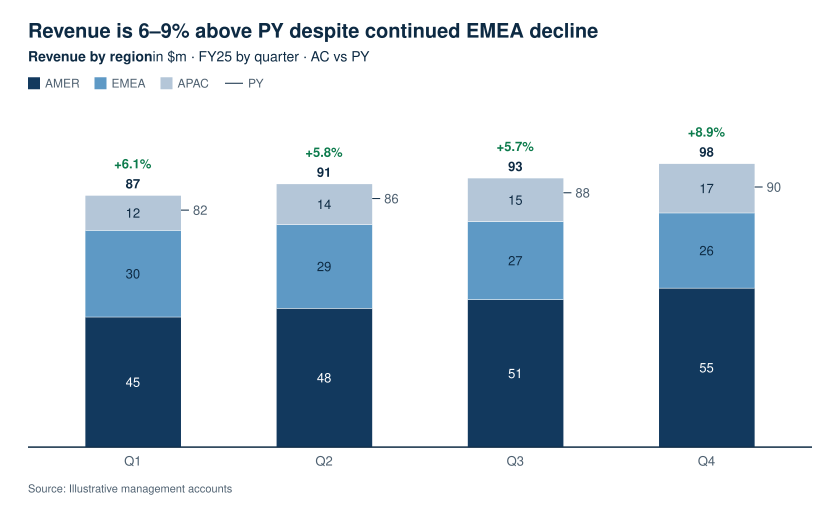

# Boardplot

Boardplot is a chart library for AI agents and React apps: one JSON spec gives a consulting-grade business chart for reports, dashboards and slides, as SVG, PNG or a React component.

**[Gallery](docs/gallery.md)** · [Manual](docs/manual.md) · [Chart reference](docs/reference/) · [AI agents](#ai-agents) · [React](#react) · [Changelog](CHANGELOG.md) · Apache-2.0

<picture>
  <source media="(prefers-color-scheme: dark)" srcset="docs/gallery/hero-dark.svg">
  
</picture>

This stacked column chart is one JSON spec drawn by `boardplot render`; the variance to the prior year above each column is computed from the data. Boardplot has <!-- BEGIN GENERATED COUNTS -->37 chart types, 82 variants and 559 example specs<!-- END GENERATED COUNTS -->; the [gallery](docs/gallery.md) shows each type with its spec.

## Why Boardplot

- Business notation is built in: actual against plan and prior year, variances, bridges, event lanes and forecasts. Totals, shares and growth rates are computed from your data, and each render reports the numbers it derived.
- Automatic label placement: one collision solver places the labels, and a render reports every label it left out. A chart that cannot fit is refused with the size it needs.
- The same spec, settings and engine version give byte-identical SVG.
- One spec, `{ "type", "data", "options" }`, works in React, the CLI and six MCP tools. A spec error comes back as JSON with the path, the expected value and a fix, so an agent can repair the spec.

## Match your design system

- Set brand colours, series colours, type sizes and spacing through theme tokens, or start from one of eight presets.
- Style tables with the same tokens, or start from the ready table look.
- Use your own font: `boardplot fonts build` makes the width tables that layout measures with. The font files must be loaded where the chart is shown, and installed where a PNG is drawn.
- Choose the locale, the number formats and the reading target: report, dashboard, slide or print.

[The theme reference](docs/reference/theme.md) lists every token.

## Examples

Each chart links to its spec in the gallery. Companies, products, sources and numbers in the examples are invented.

<a href="docs/gallery.md#bar"><picture>
  <source media="(prefers-color-scheme: dark)" srcset="docs/gallery/bar-margin-by-brand-dark.svg">
  
</picture></a>

<a href="docs/gallery.md#line"><picture>
  <source media="(prefers-color-scheme: dark)" srcset="docs/gallery/line-multiline-arr-endpoint-cagr-dark.svg">
  
</picture></a>

<a href="docs/gallery.md#dimswitch"><picture>
  <source media="(prefers-color-scheme: dark)" srcset="docs/gallery/dimswitch-statement-channels-dark.svg">
  
</picture></a>

<a href="docs/gallery.md#table"><picture>
  <source media="(prefers-color-scheme: dark)" srcset="docs/gallery/table-management-report-compact-dark.svg">
  
</picture></a>

<a href="docs/gallery.md#waterfall"><picture>
  <source media="(prefers-color-scheme: dark)" srcset="docs/gallery/waterfall-build-down-dark.svg">
  
</picture></a>

## Quick start

Boardplot needs Node.js 22.12 or newer.

```sh
npm install boardplot
cat > revenue.json <<'EOF'
{
  "name": "revenue",
  "type": "column",
  "data": {
    "categories": ["2024", "2025"],
    "series": [{ "id": "revenue", "label": "Revenue", "values": [120, 135] }]
  },
  "options": { "title": "Revenue grew 12.5 percent", "subtitle": { "measure": "Revenue" }, "unit": "$m" }
}
EOF
npx boardplot render revenue.json --out charts
```

This writes `charts/revenue.svg` and prints the result as JSON. Add `--format png` for a PNG. `npx boardplot list` shows every chart type, and `npx boardplot fixtures --type waterfall` prints complete example specs.

The package has ES module entries only (`import`, not `require`). A new `npm init` project is CommonJS, so run `npm pkg set type=module` before a server-side script imports Boardplot.

Boardplot is at 0.x: options and output can change between minor versions. [CHANGELOG.md](CHANGELOG.md) lists each change.

## AI agents

For Claude Code and Codex, install the plugin. It adds the MCP server and a chart skill. This repository is its marketplace:

```sh
claude plugin marketplace add boardplot/boardplot
claude plugin install boardplot@boardplot
```

```sh
codex plugin marketplace add boardplot/boardplot
codex plugin add boardplot@boardplot
```

The plugin installs the npm package at its own version into a Boardplot cache folder, so PNG works without a browser. For a machine without npm registry access, each release also has an offline ZIP with the runtime bundled; that route needs Chrome or Chromium for PNG. See [the plugin README](release/plugin/boardplot-marketplace/plugins/boardplot/README.md).

Any other MCP client: install the package globally once, then add the stdio server `boardplot-mcp`. It has six tools: `boardplot_list`, `boardplot_describe`, `boardplot_fixtures`, `boardplot_measure`, `boardplot_render` and `boardplot_feedback`. With a global install, npm does not run in the folder the agent works in, so that folder's npm settings cannot change which package runs. Run the same command again to update.

```sh
npm install -g boardplot
```

```json
{
  "mcpServers": {
    "boardplot": { "command": "boardplot-mcp" }
  }
}
```

Claude Code and Codex also take the server without the plugin: `claude mcp add boardplot -- boardplot-mcp` or `codex mcp add boardplot -- boardplot-mcp`.

Then ask the agent for a chart, for example "Use Boardplot to draw an EBIT bridge from this data". [llms.txt](llms.txt) indexes the manual and the chart reference for language models.

## React

React 18 or 19 is a peer dependency.

```sh
npm install boardplot react react-dom
```

```tsx
import { ColumnChart } from 'boardplot/react/column';

const data = {
  categories: [{ id: '2024', label: '2024' }, { id: '2025', label: '2025' }],
  series: [{ id: 'revenue', label: 'Revenue', values: [120, 135] }],
};

export function Revenue() {
  return <ColumnChart data={data} title="Revenue grew 12.5 percent" unit="$m" size="container" fit="content" />;
}
```

Each chart type has its own entry, such as `boardplot/react/column`. `BoardplotChart` from `boardplot/react/spec` takes a whole spec instead. The React route, in order: [Getting a chart in React](docs/manual.md#getting-a-chart-in-react), [Rows in React](docs/manual.md#rows-in-react) for query rows, [Container sizing](docs/reference/react.md#container-sizing), [Theme provider](docs/reference/react.md#theme-provider) and [Export](docs/reference/react.md#export), which ends with a complete typed PNG and SVG download.

<!-- BEGIN GENERATED CHART CATALOG -->
<!-- Generated by scripts/generate-reference.mjs from the boardplot describe, list and fixtures payloads. -->
## The catalog

37 chart types, 82 variants and 559 example specs. [fixtures.md](docs/reference/fixtures.md) lists every example spec.

| Type | Aliases | Summary |
|---|---|---|
| [`column`](docs/reference/column.md) |  | Vertical bars, grouped or stacked |
| [`bar`](docs/reference/bar.md) |  | Horizontal bars per item |
| [`line`](docs/reference/line.md) | `profile` | Lines and areas over time |
| [`dimswitch`](docs/reference/dimswitch.md) | `dim-switch-table`, `dim-switch` | KPIs by one dimension and period, from sums |
| [`table`](docs/reference/table.md) | `tbl` | Management table with totals |
| [`waterfall`](docs/reference/waterfall.md) | `bridge` | Bridge |
| [`kpi`](docs/reference/kpi.md) |  | Single-metric card |
| [`combo`](docs/reference/combo.md) |  | Columns with line or area overlays |
| [`variance`](docs/reference/variance.md) | `deviation` | Variance tier against PY, PL or FC |
| [`bullet`](docs/reference/bullet.md) |  | KPI rows with bands and target |
| [`bartable`](docs/reference/bartable.md) | `bar-table`, `table-bars` | Table rows with stacked bars, one panel per measure |
| [`pvm`](docs/reference/pvm.md) | `price-volume-mix` | Price, volume and mix bridge |
| [`pie`](docs/reference/pie.md) | `doughnut`, `donut` | Pie or doughnut of shares |
| [`status`](docs/reference/status.md) |  | Entity by period state matrix |
| [`heatmap`](docs/reference/heatmap.md) | `matrix` | Row by column matrix |
| [`gantt`](docs/reference/gantt.md) | `timeline` | Timeline with spans and events |
| [`scatter`](docs/reference/scatter.md) | `bubble` | XY/bubble |
| [`funnel`](docs/reference/funnel.md) |  | Stage funnel with conversion rates |
| [`pareto`](docs/reference/pareto.md) | `pareto-chart` | Sorted columns with cumulative curve |
| [`mekko`](docs/reference/mekko.md) | `marimekko`, `bar-mekko` | Variable-width stacked columns |
| [`sparkline`](docs/reference/sparkline.md) |  | One series as a mini line |
| [`treemap`](docs/reference/treemap.md) | `voronoi-treemap` | Part of a whole as nested areas |
| [`sankey`](docs/reference/sankey.md) |  | Flows from sources to targets in stages |
| [`grid`](docs/reference/grid.md) | `facets` | Facets and metric stacks on one category axis |
| [`slope`](docs/reference/slope.md) |  | Two-point slope lines |
| [`dot`](docs/reference/dot.md) | `cleveland`, `dumbbell`, `lollipop` | Dots, dumbbells or lollipops |
| [`cohort`](docs/reference/cohort.md) | `retention` | Retention by cohort and period |
| [`choropleth`](docs/reference/choropleth.md) |  | Region map coloured by value |
| [`butterfly`](docs/reference/butterfly.md) |  | Two mirrored bar panes |
| [`likert`](docs/reference/likert.md) | `diverging-stacked` | Diverging bars for survey scales |
| [`histogram`](docs/reference/histogram.md) | `distribution`, `frequency` | Equal-width bins of raw values |
| [`box`](docs/reference/box.md) | `boxplot`, `box-and-whisker` | Box plots of raw observations |
| [`waffle`](docs/reference/waffle.md) |  | Share of a whole as a grid of cells |
| [`pyramid`](docs/reference/pyramid.md) | `age-pyramid`, `population-pyramid` | Mirrored bands on one scale |
| [`diagram`](docs/reference/diagram.md) |  | Node and edge diagrams |
| [`tilemap`](docs/reference/tilemap.md) |  | Equal-size region tiles |
| [`creative`](docs/reference/creative.md) |  | Ad-creative review card (early alpha) |
<!-- END GENERATED CHART CATALOG -->

## Documentation

- [Gallery](docs/gallery.md): one drawn example of each chart type, with its spec
- [The manual](docs/manual.md): the spec, the MCP tools, the CLI, React, sizing, errors and themes
- [Chart reference](docs/reference/): one page per chart type, plus options, themes, React and fixtures
- [llms.txt](llms.txt): an index of the manual and the reference for language models

## Development

```sh
npm ci
npm run typecheck
npm test
npm run build
```

`npm run docs:build` regenerates `docs/reference`, the gallery, `llms.txt` and the catalog table above. [CONTRIBUTING.md](CONTRIBUTING.md) and [AGENTS.md](AGENTS.md) have the rules for a pull request. [SECURITY.md](SECURITY.md) says how to report a security problem.

## License

Apache-2.0. See [LICENSE](LICENSE) and [NOTICE.md](NOTICE.md).
