# Gallery

Boardplot has 37 chart types, 82 variants and 562 example specs. This page shows one or two charts of each type except `creative` (early alpha), drawn by `boardplot render` from the spec under it with the default theme. Companies, products, sources and numbers are invented. Every spec is a fixture that ships with the package: `boardplot fixtures --type <type> --id <id>` returns it, and [fixtures.md](reference/fixtures.md) lists all of them.

- [Most common](#most-common): [column](#column), [bar](#bar), [line](#line), [dimswitch](#dimswitch), [table](#table), [waterfall](#waterfall)
- [Variance, bridges and KPIs](#variance-bridges-and-kpis): [kpi](#kpi), [variance](#variance), [bullet](#bullet), [pvm](#pvm)
- [Trends](#trends): [combo](#combo), [pareto](#pareto), [sparkline](#sparkline), [slope](#slope)
- [Tables and scorecards](#tables-and-scorecards): [bartable](#bartable), [status](#status), [heatmap](#heatmap), [cohort](#cohort)
- [Composition](#composition): [pie](#pie), [funnel](#funnel), [mekko](#mekko), [treemap](#treemap), [waffle](#waffle), [sankey](#sankey)
- [Plans and structure](#plans-and-structure): [gantt](#gantt), [grid](#grid), [diagram](#diagram)
- [Distribution and ranking](#distribution-and-ranking): [scatter](#scatter), [dot](#dot), [butterfly](#butterfly), [histogram](#histogram), [box](#box), [pyramid](#pyramid)
- [Surveys and maps](#surveys-and-maps): [choropleth](#choropleth), [likert](#likert), [tilemap](#tilemap)

## Most common

### column

Vertical bars, grouped or stacked. [Reference](reference/column.md)

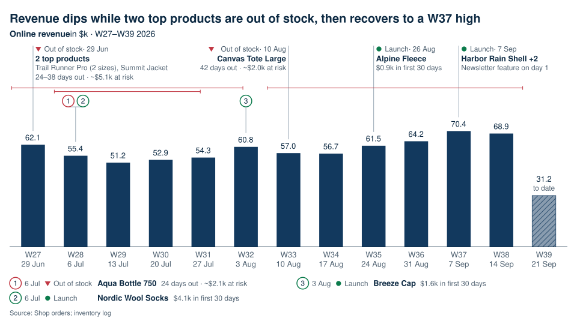

<details><summary>Spec: fixture <code>weekly-events-lane</code></summary>

```json
{
  "type": "column",
  "data": {
    "categories": [
      { "id": "w27", "label": "W27\n29 Jun", "date": "2026-06-29" },
      { "id": "w28", "label": "W28\n6 Jul", "date": "2026-07-06" },
      { "id": "w29", "label": "W29\n13 Jul", "date": "2026-07-13" },
      { "id": "w30", "label": "W30\n20 Jul", "date": "2026-07-20" },
      { "id": "w31", "label": "W31\n27 Jul", "date": "2026-07-27" },
      { "id": "w32", "label": "W32\n3 Aug", "date": "2026-08-03" },
      { "id": "w33", "label": "W33\n10 Aug", "date": "2026-08-10" },
      { "id": "w34", "label": "W34\n17 Aug", "date": "2026-08-17" },
      { "id": "w35", "label": "W35\n24 Aug", "date": "2026-08-24" },
      { "id": "w36", "label": "W36\n31 Aug", "date": "2026-08-31" },
      { "id": "w37", "label": "W37\n7 Sep", "date": "2026-09-07" },
      { "id": "w38", "label": "W38\n14 Sep", "date": "2026-09-14" },
      { "id": "w39", "label": "W39\n21 Sep", "date": "2026-09-21", "partial": true }
    ],
    "series": [
      {
        "id": "rev",
        "label": "Revenue",
        "values": [62.1, 55.4, 51.2, 52.9, 54.3, 60.8, 57, 56.7, 61.5, 64.2, 70.4, 68.9, 31.2]
      }
    ]
  },
  "options": {
    "title": "Revenue dips while two top products are out of stock, then recovers to a W37 high",
    "subtitle": { "measure": "Online revenue", "period": "W27–W39 2026" },
    "unit": "$k",
    "format": "1.0",
    "source": "Shop orders; inventory log",
    "size": { "width": 960, "height": 540 },
    "events": {
      "placement": "auto",
      "rows": 1,
      "groups": [
        { "id": "stockout", "label": "Out of stock", "tone": "bad", "glyph": "triangle" },
        { "id": "launch", "label": "Launch", "tone": "good", "glyph": "dot" }
      ]
    }
  },
  "annotations": [
    {
      "kind": "event",
      "id": "oos-runner",
      "date": "2026-06-29",
      "end": "2026-08-05",
      "group": "stockout",
      "label": "2 top products",
      "detail": ["Trail Runner Pro (2 sizes), Summit Jacket", "24–38 days out · ~$5.1k at risk"],
      "priority": 10
    },
    {
      "kind": "event",
      "id": "oos-bottle",
      "date": "2026-07-06",
      "end": "2026-07-29",
      "group": "stockout",
      "label": "Aqua Bottle 750",
      "detail": "24 days out · ~$2.1k at risk"
    },
    {
      "kind": "event",
      "id": "launch-socks",
      "date": "2026-07-06",
      "group": "launch",
      "label": "Nordic Wool Socks",
      "detail": "$4.1k in first 30 days"
    },
    {
      "kind": "event",
      "id": "launch-cap",
      "date": "2026-08-03",
      "group": "launch",
      "label": "Breeze Cap",
      "detail": "$1.6k in first 30 days"
    },
    {
      "kind": "event",
      "id": "oos-tote",
      "date": "2026-08-10",
      "end": "2026-09-20",
      "group": "stockout",
      "label": "Canvas Tote Large",
      "detail": "42 days out · ~$2.0k at risk",
      "priority": 10
    },
    {
      "kind": "event",
      "id": "launch-fleece",
      "date": "2026-08-26",
      "group": "launch",
      "label": "Alpine Fleece",
      "detail": "$0.9k in first 30 days"
    },
    {
      "kind": "event",
      "id": "launch-shell",
      "date": "2026-09-07",
      "group": "launch",
      "label": "Harbor Rain Shell",
      "detail": "Newsletter feature on day 1",
      "items": [
        {
          "label": "Home-page banner for the first two weeks",
          "detail": "Front page and the weekly email"
        },
        { "label": "Daily ad budget +10%" }
      ]
    }
  ]
}
```

</details>

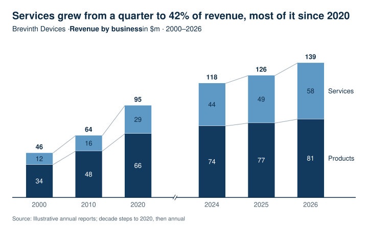

<details><summary>Spec: fixture <code>category-break-years</code></summary>

```json
{
  "type": "column",
  "data": {
    "categories": [
      { "id": "y2000", "label": "2000" },
      { "id": "y2010", "label": "2010" },
      { "id": "y2020", "label": "2020", "breakAfter": true },
      { "id": "y2024", "label": "2024" },
      { "id": "y2025", "label": "2025" },
      { "id": "y2026", "label": "2026" }
    ],
    "series": [
      { "id": "products", "label": "Products", "values": [34, 48, 66, 74, 77, 81] },
      { "id": "services", "label": "Services", "values": [12, 16, 29, 44, 49, 58] }
    ]
  },
  "options": {
    "variant": "stacked",
    "connectors": true,
    "seriesLabels": { "at": "right-edge" },
    "title": "Services grew from a quarter to 42% of revenue, most of it since 2020",
    "subtitle": { "company": "Brevinth Devices", "measure": "Revenue by business", "period": "2000–2026" },
    "unit": "$m",
    "source": "Illustrative annual reports; decade steps to 2020, then annual"
  }
}
```

</details>

### bar

Horizontal bars per item. [Reference](reference/bar.md)

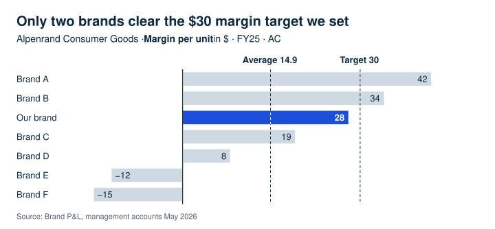

<details><summary>Spec: fixture <code>margin-by-brand</code></summary>

```json
{
  "type": "bar",
  "data": {
    "categories": [
      { "id": "brand-a", "label": "Brand A" },
      { "id": "brand-b", "label": "Brand B" },
      { "id": "our-brand", "label": "Our brand" },
      { "id": "brand-c", "label": "Brand C" },
      { "id": "brand-d", "label": "Brand D" },
      { "id": "brand-e", "label": "Brand E" },
      { "id": "brand-f", "label": "Brand F" }
    ],
    "series": [{ "id": "margin", "label": "Margin per unit", "values": [42, 34, 28, 19, 8, -12, -15] }]
  },
  "options": {
    "averageMarker": true,
    "title": "Only two brands clear the $30 margin target we set",
    "subtitle": {
      "company": "Alpenrand Consumer Goods",
      "measure": "Margin per unit",
      "period": "FY25",
      "scenarios": ["AC"]
    },
    "unit": "$",
    "source": "Brand P&L, management accounts May 2026",
    "sort": { "categories": "desc" },
    "highlight": "our-brand"
  },
  "annotations": [{ "kind": "valueLine", "value": 30, "label": "Target 30" }]
}
```

</details>

### line

Lines and areas over time. [Reference](reference/line.md)

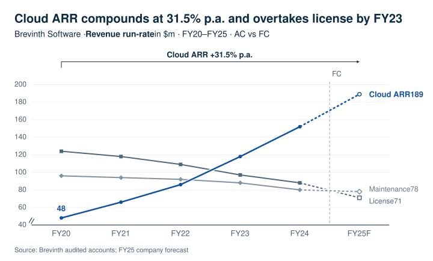

<details><summary>Spec: fixture <code>multiline-arr-endpoint-cagr</code></summary>

```json
{
  "type": "line",
  "data": {
    "categories": [
      { "id": "fy20", "label": "FY20", "date": "2020-12-31" },
      { "id": "fy21", "label": "FY21", "date": "2021-12-31" },
      { "id": "fy22", "label": "FY22", "date": "2022-12-31" },
      { "id": "fy23", "label": "FY23", "date": "2023-12-31" },
      { "id": "fy24", "label": "FY24", "date": "2024-12-31" },
      { "id": "fy25", "label": "FY25F", "date": "2025-12-31" }
    ],
    "series": [
      {
        "id": "cloud",
        "label": "Cloud ARR",
        "colorRole": "highlight",
        "values": [48, 66, 86, 118, 152, { "number": 189, "scenario": "FC" }]
      },
      {
        "id": "license",
        "label": "License",
        "values": [124, 118, 109, 97, 88, { "number": 71, "scenario": "FC" }]
      },
      {
        "id": "maintenance",
        "label": "Maintenance",
        "values": [96, 94, 92, 88, 80, { "number": 78, "scenario": "FC" }]
      }
    ]
  },
  "options": {
    "variant": "line",
    "highlight": "cloud",
    "highlightMode": "grey",
    "valueAxis": { "show": true },
    "title": "Cloud ARR compounds at 31.5% p.a. and overtakes license by FY23",
    "subtitle": {
      "company": "Brevinth Software",
      "measure": "Revenue run-rate",
      "period": "FY20–FY25",
      "scenarios": ["AC", "FC"]
    },
    "unit": "$m",
    "source": "Brevinth audited accounts; FY25 company forecast"
  },
  "annotations": [
    {
      "kind": "cagr",
      "from": { "categoryId": "fy20", "seriesId": "cloud" },
      "to": { "categoryId": "fy25", "seriesId": "cloud" }
    },
    { "kind": "abs", "at": { "categoryId": "fy20", "seriesId": "cloud" } }
  ]
}
```

</details>

### dimswitch

KPIs by one dimension and period, from sums. [Reference](reference/dimswitch.md)

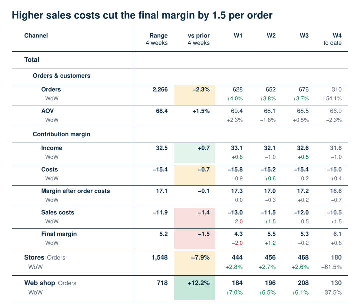

<details><summary>Spec: fixture <code>statement-channels</code></summary>

```json
{
  "type": "dimswitch",
  "data": {
    "dimension": {
      "label": "Channel",
      "total": { "id": "total", "label": "Total", "heading": "Orders & customers" },
      "members": [{ "id": "stores", "label": "Stores" }, { "id": "online", "label": "Web shop" }],
      "headline": ["orders"],
      "sums": true
    },
    "changeLabel": "WoW",
    "effectLabel": "Margin effect",
    "groupHeadings": { "Contribution margin": "Contribution margin · per order · changes per order" },
    "measures": [
      {
        "id": "orders",
        "label": "Orders",
        "scale": "count",
        "value": { "field": "orders" },
        "judge": { "family": "volume", "base": "orders" },
        "group": "Orders & customers"
      },
      {
        "id": "aov",
        "label": "AOV",
        "format": "1.2",
        "value": { "op": "div", "a": { "field": "rev" }, "b": { "field": "orders" } },
        "judge": { "family": "rate", "base": "orders" },
        "group": "Orders & customers"
      },
      {
        "id": "income",
        "label": "Income",
        "format": "1.2",
        "change": "absolute",
        "judge": { "family": "effect" },
        "group": "Contribution margin"
      },
      {
        "id": "gp",
        "label": "Gross profit",
        "value": { "op": "div", "a": { "field": "gp" }, "b": { "field": "orders" } },
        "format": "1.2",
        "change": "absolute",
        "judge": { "family": "effect" },
        "partOf": "income",
        "drivers": {
          "op": "mul",
          "a": { "op": "sub", "a": { "measure": "aovbd" }, "b": { "measure": "ret" } },
          "b": { "measure": "gm" }
        }
      },
      {
        "id": "shipi",
        "label": "Delivery charges",
        "value": { "op": "div", "a": { "field": "shipi" }, "b": { "field": "orders" } },
        "format": "1.2",
        "change": "absolute",
        "judge": { "family": "effect" },
        "partOf": "income"
      },
      {
        "id": "aovbd",
        "label": "Price before discounts",
        "value": { "op": "div", "a": { "field": "revbd" }, "b": { "field": "orders" } },
        "format": "1.2",
        "change": "absolute",
        "judge": { "family": "effect" }
      },
      {
        "id": "ret",
        "label": "Returns and refunds",
        "value": { "op": "div", "a": { "field": "returns" }, "b": { "field": "orders" } },
        "format": "1.2",
        "change": "absolute",
        "judge": { "family": "effect" }
      },
      {
        "id": "gm",
        "label": "Gross margin",
        "scale": "percent",
        "format": "1.2%",
        "change": "pp",
        "judge": { "family": "effect" },
        "value": {
          "op": "div",
          "a": { "field": "gp" },
          "b": { "op": "sub", "a": { "field": "revbd" }, "b": { "field": "returns" } },
          "factor": 100
        }
      },
      {
        "id": "costs",
        "label": "Costs",
        "format": "1.2",
        "change": "absolute",
        "judge": { "family": "effect" },
        "sign": -1,
        "group": "Contribution margin"
      },
      {
        "id": "pay",
        "label": "Payment fees",
        "value": { "op": "div", "a": { "field": "pay" }, "b": { "field": "orders" } },
        "format": "1.2",
        "change": "absolute",
        "judge": { "family": "effect" },
        "partOf": "costs"
      },
      {
        "id": "ship",
        "label": "Delivery",
        "value": { "op": "div", "a": { "field": "ship" }, "b": { "field": "orders" } },
        "format": "1.2",
        "change": "absolute",
        "judge": { "family": "effect" },
        "partOf": "costs"
      },
      {
        "id": "pick",
        "label": "Handling",
        "value": { "op": "div", "a": { "field": "pick" }, "b": { "field": "orders" } },
        "format": "1.2",
        "change": "absolute",
        "judge": { "family": "effect" },
        "partOf": "costs"
      },
      {
        "id": "cm2",
        "label": "Margin after order costs",
        "value": { "op": "sub", "a": { "measure": "income" }, "b": { "measure": "costs" } },
        "format": "1.2",
        "change": "absolute",
        "judge": { "family": "effect" },
        "result": true,
        "group": "Contribution margin"
      },
      {
        "id": "mkt",
        "label": "Sales costs",
        "format": "1.2",
        "change": "absolute",
        "judge": { "family": "effect" },
        "sign": -1,
        "group": "Contribution margin"
      },
      {
        "id": "spend",
        "label": "Advertising",
        "value": { "op": "div", "a": { "field": "spend" }, "b": { "field": "orders" } },
        "format": "1.2",
        "change": "absolute",
        "judge": { "family": "effect" },
        "partOf": "mkt"
      },
      {
        "id": "disc",
        "label": "Promotions",
        "value": { "op": "div", "a": { "field": "disc" }, "b": { "field": "orders" } },
        "format": "1.2",
        "change": "absolute",
        "judge": { "family": "effect" },
        "partOf": "mkt"
      },
      {
        "id": "cm3",
        "label": "Final margin",
        "value": { "op": "sub", "a": { "measure": "cm2" }, "b": { "measure": "mkt" } },
        "format": "1.2",
        "change": "absolute",
        "judge": { "family": "effect" },
        "result": true,
        "group": "Contribution margin"
      }
    ],
    "periods": [
      { "id": "range", "label": "Range", "subLabel": "4 weeks", "kind": "range" },
      { "id": "prior", "label": "vs prior", "subLabel": "4 weeks", "kind": "prior" },
      { "id": "w1", "label": "W1" },
      { "id": "w2", "label": "W2" },
      { "id": "w3", "label": "W3" },
      { "id": "w4", "label": "W4", "subLabel": "to date", "partial": true }
    ],
    "facts": [
      {
        "memberId": "stores",
        "periodId": "prior",
        "sums": {
          "orders": 1680,
          "rev": 114912,
          "revbd": 117936,
          "returns": 672,
          "gp": 51127.12,
          "shipi": 3864,
          "pay": 2856,
          "ship": 16464,
          "pick": 4267.2,
          "spend": 13104,
          "disc": 4536
        }
      },
      {
        "memberId": "stores",
        "periodId": "range",
        "sums": {
          "orders": 1548,
          "rev": 108792,
          "revbd": 111942,
          "returns": 1346.4,
          "gp": 48712.67,
          "shipi": 3924,
          "pay": 2813.4,
          "ship": 16261.2,
          "pick": 4222.8,
          "spend": 14256,
          "disc": 5634
        }
      },
      {
        "memberId": "stores",
        "periodId": "w1",
        "sums": {
          "orders": 444,
          "rev": 31790.4,
          "revbd": 32767.2,
          "returns": 532.8,
          "gp": 14312.07,
          "shipi": 1198.8,
          "pay": 843.6,
          "ship": 4884,
          "pick": 1269.84,
          "spend": 4528.8,
          "disc": 1909.2
        },
        "ref": {
          "orders": 432,
          "rev": 30240,
          "revbd": 31104,
          "returns": 345.6,
          "gp": 13533.7,
          "shipi": 1080,
          "pay": 777.6,
          "ship": 4492.8,
          "pick": 1166.4,
          "spend": 3888,
          "disc": 1512
        }
      },
      {
        "memberId": "stores",
        "periodId": "w2",
        "sums": {
          "orders": 456,
          "rev": 31555.2,
          "revbd": 32421.6,
          "returns": 273.6,
          "gp": 14016.53,
          "shipi": 1094.4,
          "pay": 798,
          "ship": 4605.6,
          "pick": 1194.72,
          "spend": 3830.4,
          "disc": 1413.6
        },
        "ref": {
          "orders": 444,
          "rev": 31790.4,
          "revbd": 32767.2,
          "returns": 532.8,
          "gp": 14312.07,
          "shipi": 1198.8,
          "pay": 843.6,
          "ship": 4884,
          "pick": 1269.84,
          "spend": 4528.8,
          "disc": 1909.2
        }
      },
      {
        "memberId": "stores",
        "periodId": "w3",
        "sums": {
          "orders": 468,
          "rev": 33134.4,
          "revbd": 34117.2,
          "returns": 468,
          "gp": 14805.65,
          "shipi": 1216.8,
          "pay": 865.8,
          "ship": 5007.6,
          "pick": 1301.04,
          "spend": 4492.8,
          "disc": 1825.2
        },
        "ref": {
          "orders": 456,
          "rev": 31555.2,
          "revbd": 32421.6,
          "returns": 273.6,
          "gp": 14016.53,
          "shipi": 1094.4,
          "pay": 798,
          "ship": 4605.6,
          "pick": 1194.72,
          "spend": 3830.4,
          "disc": 1413.6
        }
      },
      {
        "memberId": "stores",
        "periodId": "w4",
        "sums": {
          "orders": 180,
          "rev": 12312,
          "revbd": 12636,
          "returns": 72,
          "gp": 5578.42,
          "shipi": 414,
          "pay": 306,
          "ship": 1764,
          "pick": 457.2,
          "spend": 1404,
          "disc": 486
        },
        "ref": {
          "orders": 468,
          "rev": 33134.4,
          "revbd": 34117.2,
          "returns": 468,
          "gp": 14805.65,
          "shipi": 1216.8,
          "pay": 865.8,
          "ship": 5007.6,
          "pick": 1301.04,
          "spend": 4492.8,
          "disc": 1825.2
        }
      },
      {
        "memberId": "online",
        "periodId": "prior",
        "sums": {
          "orders": 640,
          "rev": 41472,
          "revbd": 42816,
          "returns": 896,
          "gp": 17187.2,
          "shipi": 1664,
          "pay": 1184,
          "ship": 7488,
          "pick": 1779.2,
          "spend": 4224,
          "disc": 2496
        }
      },
      {
        "memberId": "online",
        "periodId": "range",
        "sums": {
          "orders": 718,
          "rev": 46203.2,
          "revbd": 47670.6,
          "returns": 924.4,
          "gp": 19137.52,
          "shipi": 1826.4,
          "pay": 1308.1,
          "ship": 8279.4,
          "pick": 1963.72,
          "spend": 4496.4,
          "disc": 2638.6
        }
      },
      {
        "memberId": "online",
        "periodId": "w1",
        "sums": {
          "orders": 184,
          "rev": 11776,
          "revbd": 12144,
          "returns": 220.8,
          "gp": 4840.82,
          "shipi": 460,
          "pay": 331.2,
          "ship": 2097.6,
          "pick": 496.8,
          "spend": 1104,
          "disc": 644
        },
        "ref": {
          "orders": 172,
          "rev": 10732.8,
          "revbd": 11042.4,
          "returns": 137.6,
          "gp": 4514.59,
          "shipi": 395.6,
          "pay": 292.4,
          "ship": 1857.6,
          "pick": 436.88,
          "spend": 825.6,
          "disc": 464.4
        }
      },
      {
        "memberId": "online",
        "periodId": "w2",
        "sums": {
          "orders": 196,
          "rev": 12857.6,
          "revbd": 13288.8,
          "returns": 313.6,
          "gp": 5319.83,
          "shipi": 529.2,
          "pay": 372.4,
          "ship": 2352,
          "pick": 560.56,
          "spend": 1411.2,
          "disc": 842.8
        },
        "ref": {
          "orders": 184,
          "rev": 11776,
          "revbd": 12144,
          "returns": 220.8,
          "gp": 4840.82,
          "shipi": 460,
          "pay": 331.2,
          "ship": 2097.6,
          "pick": 496.8,
          "spend": 1104,
          "disc": 644
        }
      },
      {
        "memberId": "online",
        "periodId": "w3",
        "sums": {
          "orders": 208,
          "rev": 13145.6,
          "revbd": 13540.8,
          "returns": 208,
          "gp": 5519.78,
          "shipi": 499.2,
          "pay": 364,
          "ship": 2308.8,
          "pick": 544.96,
          "spend": 1123.2,
          "disc": 644.8
        },
        "ref": {
          "orders": 196,
          "rev": 12857.6,
          "revbd": 13288.8,
          "returns": 313.6,
          "gp": 5319.83,
          "shipi": 529.2,
          "pay": 372.4,
          "ship": 2352,
          "pick": 560.56,
          "spend": 1411.2,
          "disc": 842.8
        }
      },
      {
        "memberId": "online",
        "periodId": "w4",
        "sums": {
          "orders": 130,
          "rev": 8424,
          "revbd": 8697,
          "returns": 182,
          "gp": 3457.09,
          "shipi": 338,
          "pay": 240.5,
          "ship": 1521,
          "pick": 361.4,
          "spend": 858,
          "disc": 507
        },
        "ref": {
          "orders": 208,
          "rev": 13145.6,
          "revbd": 13540.8,
          "returns": 208,
          "gp": 5519.78,
          "shipi": 499.2,
          "pay": 364,
          "ship": 2308.8,
          "pick": 544.96,
          "spend": 1123.2,
          "disc": 644.8
        }
      }
    ]
  },
  "options": {
    "title": "Higher sales costs cut the final margin by 1.5 per order",
    "variant": "by-member",
    "depth": 1,
    "signs": "signed",
    "judgements": "all",
    "thresholds": { "effect": [0.3, 1] },
    "widths": { "label": 260, "range": 84, "change": 84, "period": 66 },
    "theme": {
      "preset": "boardroom",
      "overrides": {
        "table": {
          "head": { "weight": 700, "case": "asis" },
          "section": { "weight": 700, "tracking": 0.08, "ink": "ink" },
          "weights": {
            "member": 700,
            "measure": 600,
            "subtotal": 600,
            "result": 700,
            "figures": { "subtotal": 600, "result": 700 }
          },
          "tones": "fill",
          "headRule": "ink",
          "ruleWidths": { "head": 2 },
          "resultRule": "ink",
          "finalRule": "double",
          "driver": { "italic": true },
          "blockRule": "rule",
          "mark": "boxed",
          "ofWhich": "ink",
          "endRule": "none"
        }
      }
    }
  }
}
```

</details>

### table

Management table with totals. [Reference](reference/table.md)

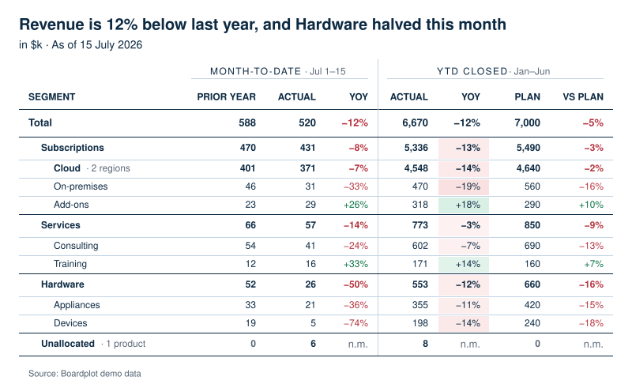

<details><summary>Spec: fixture <code>management-report-compact</code></summary>

```json
{
  "type": "table",
  "data": {
    "columnGroups": [
      {
        "id": "g-mtd",
        "label": "Month-to-Date",
        "note": "Jul 1–15",
        "columns": ["mtdLy", "mtdAc", "mtdYoY"]
      },
      {
        "id": "g-ytdc",
        "label": "YTD Closed",
        "note": "Jan–Jun",
        "columns": ["ycLy", "ycAc", "ycYoY", "ycPlan", "ycVsPlan"]
      }
    ],
    "columnToggles": [{ "id": "ytd-prior-year", "label": "YTD Closed prior year", "columns": ["ycLy"] }],
    "columns": [
      { "id": "label", "kind": "rowLabel", "label": "Segment" },
      { "id": "mtdLy", "kind": "value", "label": "Prior year", "format": "1,234", "width": 106 },
      { "id": "mtdAc", "kind": "value", "label": "Actual", "format": "1,234", "width": 76 },
      {
        "id": "mtdYoY",
        "kind": "computed",
        "label": "YoY",
        "calc": { "op": "percentDelta", "a": "mtdAc", "b": "mtdLy" },
        "polarity": "higherIsBetter",
        "materiality": { "pct": 0.5 },
        "format": "+1%",
        "width": 66
      },
      { "id": "ycLy", "kind": "value", "label": "Prior year", "format": "1,234", "width": 106 },
      { "id": "ycAc", "kind": "value", "label": "Actual", "width": 76 },
      {
        "id": "ycYoY",
        "kind": "computed",
        "label": "YoY",
        "calc": { "op": "percentDelta", "a": "ycAc", "b": "ycLy" },
        "format": "+1%",
        "width": 66
      },
      { "id": "ycPlan", "kind": "value", "label": "Plan", "format": "1,234", "width": 76 },
      {
        "id": "ycVsPlan",
        "kind": "computed",
        "label": "vs Plan",
        "calc": { "op": "percentDelta", "a": "ycAc", "b": "ycPlan" },
        "polarity": "higherIsBetter",
        "materiality": { "pct": 0.5 },
        "format": "+1%",
        "width": 80
      }
    ],
    "rows": [
      {
        "id": "seg-subscriptions",
        "label": "Subscriptions",
        "children": [
          {
            "id": "subs-cloud",
            "label": "Cloud",
            "children": [
              {
                "id": "cloud-europe",
                "label": "Europe",
                "children": [
                  {
                    "id": "europe-eu",
                    "label": "EU",
                    "children": [
                      {
                        "id": "eu-dach",
                        "label": "DACH",
                        "cells": {
                          "mtdLy": 180,
                          "mtdAc": 152,
                          "laLy": 360,
                          "laBilled": 150,
                          "laBooked": 70,
                          "laRenew": 45,
                          "laUsage": 20,
                          "laPipe": 18,
                          "laPlan": 310,
                          "ycLy": 2300,
                          "ycAc": 1820,
                          "ycPlan": 1790,
                          "fpLy": 4300,
                          "fpPace": 3690,
                          "fpPlan": 3650,
                          "foLy": 4300,
                          "foOut": 3720
                        }
                      },
                      {
                        "id": "eu-nordics",
                        "label": "Nordics",
                        "cells": {
                          "mtdLy": 62,
                          "mtdAc": 58,
                          "laLy": 128,
                          "laBilled": 61,
                          "laBooked": 30,
                          "laRenew": 18,
                          "laUsage": 9,
                          "laPipe": 6,
                          "laPlan": 135,
                          "ycLy": 760,
                          "ycAc": 742,
                          "ycPlan": 790,
                          "fpLy": 1540,
                          "fpPace": 1505,
                          "fpPlan": 1600,
                          "foLy": 1540,
                          "foOut": 1530
                        }
                      }
                    ]
                  },
                  {
                    "id": "europe-uk",
                    "label": "UK",
                    "cells": {
                      "mtdLy": 88,
                      "mtdAc": 97,
                      "laLy": 220,
                      "laBilled": 96,
                      "laBooked": 41,
                      "laRenew": 27,
                      "laUsage": 12,
                      "laPipe": 14,
                      "laPlan": 186,
                      "ycLy": 1300,
                      "ycAc": 1124,
                      "ycPlan": 1100,
                      "fpLy": 2500,
                      "fpPace": 2280,
                      "fpPlan": 2240,
                      "foLy": 2500,
                      "foOut": 2300
                    }
                  }
                ]
              },
              {
                "id": "cloud-americas",
                "label": "Americas",
                "cells": {
                  "mtdLy": 71,
                  "mtdAc": 64,
                  "laLy": 152,
                  "laBilled": 70,
                  "laBooked": 33,
                  "laRenew": 22,
                  "laUsage": 10,
                  "laPipe": 9,
                  "laPlan": 165,
                  "ycLy": 905,
                  "ycAc": 862,
                  "ycPlan": 960,
                  "fpLy": 1830,
                  "fpPace": 1745,
                  "fpPlan": 1940,
                  "foLy": 1830,
                  "foOut": 1770
                }
              }
            ]
          },
          {
            "id": "subs-onprem",
            "label": "On-premises",
            "cells": {
              "mtdLy": 46,
              "mtdAc": 31,
              "laLy": 95,
              "laBilled": 33,
              "laBooked": 18,
              "laRenew": 12,
              "laUsage": 6,
              "laPipe": 4,
              "laPlan": 92,
              "ycLy": 580,
              "ycAc": 470,
              "ycPlan": 560,
              "fpLy": 1160,
              "fpPace": 950,
              "fpPlan": 1120,
              "foLy": 1160,
              "foOut": 1010
            }
          },
          {
            "id": "subs-addons",
            "label": "Add-ons",
            "cells": {
              "mtdLy": 23,
              "mtdAc": 29,
              "laLy": 47,
              "laBilled": 28,
              "laBooked": 9,
              "laRenew": 6,
              "laUsage": 3,
              "laPipe": 5,
              "laPlan": 49,
              "ycLy": 270,
              "ycAc": 318,
              "ycPlan": 290,
              "fpLy": 560,
              "fpPace": 640,
              "fpPlan": 590,
              "foLy": 560
            }
          }
        ]
      },
      {
        "id": "seg-services",
        "label": "Services",
        "children": [
          {
            "id": "svc-consulting",
            "label": "Consulting",
            "cells": {
              "mtdLy": 54,
              "mtdAc": 41,
              "laLy": 110,
              "laBilled": 42,
              "laBooked": 25,
              "laRenew": 14,
              "laUsage": 8,
              "laPipe": 10,
              "laPlan": 118,
              "ycLy": 650,
              "ycAc": 602,
              "ycPlan": 690,
              "fpLy": 1310,
              "fpPace": 1215,
              "fpPlan": 1380,
              "foLy": 1310,
              "foOut": 1240
            }
          },
          {
            "id": "svc-training",
            "label": "Training",
            "cells": {
              "mtdLy": 12,
              "mtdAc": 16,
              "laLy": 26,
              "laBilled": 15,
              "laBooked": 5,
              "laRenew": 3,
              "laUsage": 2,
              "laPipe": 2,
              "laPlan": 28,
              "ycLy": 150,
              "ycAc": 171,
              "ycPlan": 160,
              "fpLy": 305,
              "fpPace": 342,
              "fpPlan": 320,
              "foLy": 305,
              "foOut": 350
            }
          }
        ]
      },
      {
        "id": "seg-hardware",
        "label": "Hardware",
        "children": [
          {
            "id": "hw-appliances",
            "label": "Appliances",
            "cells": {
              "mtdLy": 33,
              "mtdAc": 21,
              "laLy": 64,
              "laBilled": 25,
              "laBooked": 12,
              "laRenew": 6,
              "laUsage": 2,
              "laPipe": 3,
              "laPlan": 70,
              "ycLy": 400,
              "ycAc": 355,
              "ycPlan": 420,
              "fpLy": 790,
              "fpPace": 700,
              "fpPlan": 840,
              "foLy": 790,
              "foOut": { "state": "na" }
            }
          },
          {
            "id": "hw-devices",
            "label": "Devices",
            "cells": {
              "mtdLy": 19,
              "mtdAc": 5,
              "laLy": 38,
              "laBilled": 9,
              "laBooked": 4,
              "laRenew": 2,
              "laUsage": 1,
              "laPipe": 0,
              "laPlan": 40,
              "ycLy": 230,
              "ycAc": 198,
              "ycPlan": 240,
              "fpLy": 450,
              "fpPace": 395,
              "fpPlan": 480,
              "foLy": 450,
              "foOut": 410
            }
          }
        ]
      },
      {
        "id": "seg-unallocated",
        "label": "Unallocated",
        "children": [
          {
            "id": "unalloc-other",
            "label": "Other",
            "cells": {
              "mtdLy": 0,
              "mtdAc": 6,
              "laLy": 0,
              "laBilled": 3,
              "laBooked": 2,
              "laRenew": 1,
              "laUsage": 1,
              "laPipe": 0,
              "laPlan": 0,
              "ycLy": 0,
              "ycAc": 8,
              "ycPlan": 0,
              "fpLy": 0,
              "fpPace": 15,
              "fpPlan": 0,
              "foLy": 0,
              "foOut": 15
            }
          }
        ]
      },
      {
        "id": "total",
        "label": "Total",
        "role": "total",
        "totalPolicy": "validate",
        "cells": {
          "mtdLy": 588,
          "mtdAc": 520,
          "laLy": 1240,
          "laBilled": 532,
          "laBooked": 249,
          "laRenew": 156,
          "laUsage": 74,
          "laPipe": 71,
          "laPlan": 1193,
          "ycLy": 7545,
          "ycAc": 6670,
          "ycPlan": 7000,
          "fpLy": 14745,
          "fpPace": 13477,
          "fpPlan": 14160,
          "foLy": 14745,
          "foOut": 12345
        }
      }
    ],
    "levelNouns": [
      { "one": "segment", "other": "segments" },
      { "one": "product", "other": "products" },
      { "one": "region", "other": "regions" },
      { "one": "area", "other": "areas" },
      { "one": "market", "other": "markets" }
    ]
  },
  "options": {
    "variant": "hierarchy",
    "totalPosition": "top",
    "levelOffset": 1,
    "encodings": { "ycYoY": { "type": "heat", "cap": { "pct": 20 }, "alpha": 0.18 } },
    "density": "compact",
    "locale": { "decimal": ".", "thousands": ",", "minusGlyph": "−" },
    "size": { "width": 800 },
    "anchorWash": true,
    "expansion": { "depth": 1, "collapsed": ["seg-unallocated"] },
    "title": "Revenue is 12% below last year, and Hardware halved this month",
    "subtitle": "in $k · As of 15 July 2026",
    "source": "Boardplot demo data"
  }
}
```

</details>

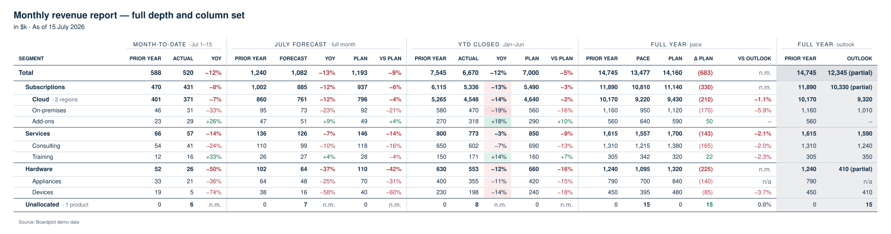

<details><summary>Spec: fixture <code>management-report</code></summary>

```json
{
  "type": "table",
  "data": {
    "columnGroups": [
      {
        "id": "g-mtd",
        "label": "Month-to-Date",
        "note": "Jul 1–15",
        "columns": ["mtdLy", "mtdAc", "mtdYoY"]
      },
      {
        "id": "g-forecast",
        "label": "July Forecast",
        "note": "full month",
        "columns": [
          "laLy",
          "laFc",
          "laBilled",
          "laBooked",
          "laRenew",
          "laUsage",
          "laPipe",
          "laYoY",
          "laPlan",
          "laVsPlan"
        ]
      },
      {
        "id": "g-ytdc",
        "label": "YTD Closed",
        "note": "Jan–Jun",
        "columns": ["ycLy", "ycAc", "ycYoY", "ycPlan", "ycVsPlan"]
      },
      {
        "id": "g-pace",
        "label": "Full Year",
        "note": "pace",
        "columns": ["fpLy", "fpPace", "fpPlan", "fpDelta", "fpVsOut"]
      },
      {
        "id": "g-outlook",
        "label": "Full Year",
        "note": "outlook",
        "columns": ["foLy", "foOut"],
        "band": true
      }
    ],
    "columnToggles": [
      {
        "id": "forecast-detail",
        "label": "Forecast detail",
        "columns": ["laBilled", "laBooked", "laRenew", "laUsage", "laPipe"]
      },
      {
        "id": "mtd-band",
        "label": "Month-to-Date",
        "columns": ["mtdLy", "mtdAc", "mtdYoY"],
        "defaultVisible": true
      },
      {
        "id": "ytd-closed-band",
        "label": "YTD Closed",
        "columns": ["ycLy", "ycAc", "ycYoY", "ycPlan", "ycVsPlan"],
        "defaultVisible": true
      },
      {
        "id": "full-year-pace-band",
        "label": "Full Year Pace",
        "columns": ["fpLy", "fpPace", "fpPlan", "fpDelta", "fpVsOut"],
        "defaultVisible": true
      },
      {
        "id": "full-year-outlook-band",
        "label": "Full Year Outlook",
        "columns": ["foLy", "foOut"],
        "defaultVisible": true
      }
    ],
    "columns": [
      { "id": "label", "kind": "rowLabel", "label": "Segment" },
      { "id": "mtdLy", "kind": "value", "label": "Prior year", "format": "1,234", "width": 106 },
      { "id": "mtdAc", "kind": "value", "label": "Actual", "format": "1,234", "width": 76 },
      {
        "id": "mtdYoY",
        "kind": "computed",
        "label": "YoY",
        "calc": { "op": "percentDelta", "a": "mtdAc", "b": "mtdLy" },
        "polarity": "higherIsBetter",
        "materiality": { "pct": 0.5 },
        "format": "+1%",
        "width": 66
      },
      { "id": "laLy", "kind": "value", "label": "Prior year", "format": "1,234", "width": 106 },
      {
        "id": "laFc",
        "kind": "computed",
        "label": "Forecast",
        "calc": {
          "op": "add",
          "a": { "ref": "laBilled" },
          "b": {
            "op": "add",
            "a": { "ref": "laBooked" },
            "b": {
              "op": "add",
              "a": { "ref": "laRenew" },
              "b": { "op": "add", "a": { "ref": "laUsage" }, "b": { "ref": "laPipe" } }
            }
          }
        },
        "format": "1,234",
        "width": 96
      },
      { "id": "laBilled", "kind": "value", "label": "Billed", "format": "1,234", "width": 92 },
      { "id": "laBooked", "kind": "value", "label": "Booked", "format": "1,234", "width": 92 },
      { "id": "laRenew", "kind": "value", "label": "Renewals", "format": "1,234", "width": 92 },
      { "id": "laUsage", "kind": "value", "label": "Usage", "format": "1,234", "width": 92 },
      { "id": "laPipe", "kind": "value", "label": "Pipeline", "format": "1,234", "width": 92 },
      {
        "id": "laYoY",
        "kind": "computed",
        "label": "YoY",
        "calc": {
          "op": "mul",
          "a": {
            "op": "div",
            "a": {
              "op": "sub",
              "a": {
                "op": "add",
                "a": { "ref": "laBilled" },
                "b": {
                  "op": "add",
                  "a": { "ref": "laBooked" },
                  "b": {
                    "op": "add",
                    "a": { "ref": "laRenew" },
                    "b": { "op": "add", "a": { "ref": "laUsage" }, "b": { "ref": "laPipe" } }
                  }
                }
              },
              "b": { "ref": "laLy" }
            },
            "b": { "ref": "laLy" }
          },
          "b": { "lit": 100 }
        },
        "polarity": "higherIsBetter",
        "format": "+1%",
        "width": 66
      },
      { "id": "laPlan", "kind": "value", "label": "Plan", "format": "1,234", "width": 76 },
      {
        "id": "laVsPlan",
        "kind": "computed",
        "label": "vs Plan",
        "calc": {
          "op": "mul",
          "a": {
            "op": "div",
            "a": {
              "op": "sub",
              "a": {
                "op": "add",
                "a": { "ref": "laBilled" },
                "b": {
                  "op": "add",
                  "a": { "ref": "laBooked" },
                  "b": {
                    "op": "add",
                    "a": { "ref": "laRenew" },
                    "b": { "op": "add", "a": { "ref": "laUsage" }, "b": { "ref": "laPipe" } }
                  }
                }
              },
              "b": { "ref": "laPlan" }
            },
            "b": { "ref": "laPlan" }
          },
          "b": { "lit": 100 }
        },
        "polarity": "higherIsBetter",
        "materiality": { "pct": 0.5 },
        "format": "+1%",
        "width": 80
      },
      { "id": "ycLy", "kind": "value", "label": "Prior year", "format": "1,234", "width": 106 },
      { "id": "ycAc", "kind": "value", "label": "Actual", "width": 76 },
      {
        "id": "ycYoY",
        "kind": "computed",
        "label": "YoY",
        "calc": { "op": "percentDelta", "a": "ycAc", "b": "ycLy" },
        "format": "+1%",
        "width": 66
      },
      { "id": "ycPlan", "kind": "value", "label": "Plan", "format": "1,234", "width": 76 },
      {
        "id": "ycVsPlan",
        "kind": "computed",
        "label": "vs Plan",
        "calc": { "op": "percentDelta", "a": "ycAc", "b": "ycPlan" },
        "polarity": "higherIsBetter",
        "materiality": { "pct": 0.5 },
        "format": "+1%",
        "width": 80
      },
      { "id": "fpLy", "kind": "value", "label": "Prior year", "format": "1,234", "width": 106 },
      { "id": "fpPace", "kind": "value", "label": "Pace", "format": "1,234", "width": 76 },
      { "id": "fpPlan", "kind": "value", "label": "Plan", "format": "1,234", "width": 76 },
      {
        "id": "fpDelta",
        "kind": "computed",
        "label": "Δ Plan",
        "calc": { "op": "sub", "a": { "ref": "fpPace" }, "b": { "ref": "fpPlan" } },
        "polarity": "higherIsBetter",
        "format": "(1,234)",
        "width": 72
      },
      {
        "id": "fpVsOut",
        "kind": "computed",
        "label": "vs Outlook",
        "calc": { "op": "percentDelta", "a": "fpPace", "b": "foOut" },
        "format": "+1.1%",
        "polarity": "higherIsBetter",
        "materiality": { "pct": 0.5 },
        "width": 138
      },
      { "id": "foLy", "kind": "value", "label": "Prior year", "format": "1,234", "width": 106 },
      {
        "id": "foOut",
        "kind": "value",
        "label": "Outlook",
        "format": "1,234",
        "nulls": "skip",
        "width": 132
      }
    ],
    "rows": [
      {
        "id": "seg-subscriptions",
        "label": "Subscriptions",
        "children": [
          {
            "id": "subs-cloud",
            "label": "Cloud",
            "children": [
              {
                "id": "cloud-europe",
                "label": "Europe",
                "children": [
                  {
                    "id": "europe-eu",
                    "label": "EU",
                    "children": [
                      {
                        "id": "eu-dach",
                        "label": "DACH",
                        "cells": {
                          "mtdLy": 180,
                          "mtdAc": 152,
                          "laLy": 360,
                          "laBilled": 150,
                          "laBooked": 70,
                          "laRenew": 45,
                          "laUsage": 20,
                          "laPipe": 18,
                          "laPlan": 310,
                          "ycLy": 2300,
                          "ycAc": 1820,
                          "ycPlan": 1790,
                          "fpLy": 4300,
                          "fpPace": 3690,
                          "fpPlan": 3650,
                          "foLy": 4300,
                          "foOut": 3720
                        }
                      },
                      {
                        "id": "eu-nordics",
                        "label": "Nordics",
                        "cells": {
                          "mtdLy": 62,
                          "mtdAc": 58,
                          "laLy": 128,
                          "laBilled": 61,
                          "laBooked": 30,
                          "laRenew": 18,
                          "laUsage": 9,
                          "laPipe": 6,
                          "laPlan": 135,
                          "ycLy": 760,
                          "ycAc": 742,
                          "ycPlan": 790,
                          "fpLy": 1540,
                          "fpPace": 1505,
                          "fpPlan": 1600,
                          "foLy": 1540,
                          "foOut": 1530
                        }
                      }
                    ]
                  },
                  {
                    "id": "europe-uk",
                    "label": "UK",
                    "cells": {
                      "mtdLy": 88,
                      "mtdAc": 97,
                      "laLy": 220,
                      "laBilled": 96,
                      "laBooked": 41,
                      "laRenew": 27,
                      "laUsage": 12,
                      "laPipe": 14,
                      "laPlan": 186,
                      "ycLy": 1300,
                      "ycAc": 1124,
                      "ycPlan": 1100,
                      "fpLy": 2500,
                      "fpPace": 2280,
                      "fpPlan": 2240,
                      "foLy": 2500,
                      "foOut": 2300
                    }
                  }
                ]
              },
              {
                "id": "cloud-americas",
                "label": "Americas",
                "cells": {
                  "mtdLy": 71,
                  "mtdAc": 64,
                  "laLy": 152,
                  "laBilled": 70,
                  "laBooked": 33,
                  "laRenew": 22,
                  "laUsage": 10,
                  "laPipe": 9,
                  "laPlan": 165,
                  "ycLy": 905,
                  "ycAc": 862,
                  "ycPlan": 960,
                  "fpLy": 1830,
                  "fpPace": 1745,
                  "fpPlan": 1940,
                  "foLy": 1830,
                  "foOut": 1770
                }
              }
            ]
          },
          {
            "id": "subs-onprem",
            "label": "On-premises",
            "cells": {
              "mtdLy": 46,
              "mtdAc": 31,
              "laLy": 95,
              "laBilled": 33,
              "laBooked": 18,
              "laRenew": 12,
              "laUsage": 6,
              "laPipe": 4,
              "laPlan": 92,
              "ycLy": 580,
              "ycAc": 470,
              "ycPlan": 560,
              "fpLy": 1160,
              "fpPace": 950,
              "fpPlan": 1120,
              "foLy": 1160,
              "foOut": 1010
            }
          },
          {
            "id": "subs-addons",
            "label": "Add-ons",
            "cells": {
              "mtdLy": 23,
              "mtdAc": 29,
              "laLy": 47,
              "laBilled": 28,
              "laBooked": 9,
              "laRenew": 6,
              "laUsage": 3,
              "laPipe": 5,
              "laPlan": 49,
              "ycLy": 270,
              "ycAc": 318,
              "ycPlan": 290,
              "fpLy": 560,
              "fpPace": 640,
              "fpPlan": 590,
              "foLy": 560
            }
          }
        ]
      },
      {
        "id": "seg-services",
        "label": "Services",
        "children": [
          {
            "id": "svc-consulting",
            "label": "Consulting",
            "cells": {
              "mtdLy": 54,
              "mtdAc": 41,
              "laLy": 110,
              "laBilled": 42,
              "laBooked": 25,
              "laRenew": 14,
              "laUsage": 8,
              "laPipe": 10,
              "laPlan": 118,
              "ycLy": 650,
              "ycAc": 602,
              "ycPlan": 690,
              "fpLy": 1310,
              "fpPace": 1215,
              "fpPlan": 1380,
              "foLy": 1310,
              "foOut": 1240
            }
          },
          {
            "id": "svc-training",
            "label": "Training",
            "cells": {
              "mtdLy": 12,
              "mtdAc": 16,
              "laLy": 26,
              "laBilled": 15,
              "laBooked": 5,
              "laRenew": 3,
              "laUsage": 2,
              "laPipe": 2,
              "laPlan": 28,
              "ycLy": 150,
              "ycAc": 171,
              "ycPlan": 160,
              "fpLy": 305,
              "fpPace": 342,
              "fpPlan": 320,
              "foLy": 305,
              "foOut": 350
            }
          }
        ]
      },
      {
        "id": "seg-hardware",
        "label": "Hardware",
        "children": [
          {
            "id": "hw-appliances",
            "label": "Appliances",
            "cells": {
              "mtdLy": 33,
              "mtdAc": 21,
              "laLy": 64,
              "laBilled": 25,
              "laBooked": 12,
              "laRenew": 6,
              "laUsage": 2,
              "laPipe": 3,
              "laPlan": 70,
              "ycLy": 400,
              "ycAc": 355,
              "ycPlan": 420,
              "fpLy": 790,
              "fpPace": 700,
              "fpPlan": 840,
              "foLy": 790,
              "foOut": { "state": "na" }
            }
          },
          {
            "id": "hw-devices",
            "label": "Devices",
            "cells": {
              "mtdLy": 19,
              "mtdAc": 5,
              "laLy": 38,
              "laBilled": 9,
              "laBooked": 4,
              "laRenew": 2,
              "laUsage": 1,
              "laPipe": 0,
              "laPlan": 40,
              "ycLy": 230,
              "ycAc": 198,
              "ycPlan": 240,
              "fpLy": 450,
              "fpPace": 395,
              "fpPlan": 480,
              "foLy": 450,
              "foOut": 410
            }
          }
        ]
      },
      {
        "id": "seg-unallocated",
        "label": "Unallocated",
        "children": [
          {
            "id": "unalloc-other",
            "label": "Other",
            "cells": {
              "mtdLy": 0,
              "mtdAc": 6,
              "laLy": 0,
              "laBilled": 3,
              "laBooked": 2,
              "laRenew": 1,
              "laUsage": 1,
              "laPipe": 0,
              "laPlan": 0,
              "ycLy": 0,
              "ycAc": 8,
              "ycPlan": 0,
              "fpLy": 0,
              "fpPace": 15,
              "fpPlan": 0,
              "foLy": 0,
              "foOut": 15
            }
          }
        ]
      },
      {
        "id": "total",
        "label": "Total",
        "role": "total",
        "totalPolicy": "validate",
        "cells": {
          "mtdLy": 588,
          "mtdAc": 520,
          "laLy": 1240,
          "laBilled": 532,
          "laBooked": 249,
          "laRenew": 156,
          "laUsage": 74,
          "laPipe": 71,
          "laPlan": 1193,
          "ycLy": 7545,
          "ycAc": 6670,
          "ycPlan": 7000,
          "fpLy": 14745,
          "fpPace": 13477,
          "fpPlan": 14160,
          "foLy": 14745,
          "foOut": 12345
        }
      }
    ],
    "levelNouns": [
      { "one": "segment", "other": "segments" },
      { "one": "product", "other": "products" },
      { "one": "region", "other": "regions" },
      { "one": "area", "other": "areas" },
      { "one": "market", "other": "markets" }
    ]
  },
  "options": {
    "variant": "hierarchy",
    "totalPosition": "top",
    "levelOffset": 1,
    "encodings": { "ycYoY": { "type": "heat", "cap": { "pct": 20 }, "alpha": 0.18 } },
    "density": "compact",
    "locale": { "decimal": ".", "thousands": ",", "minusGlyph": "−" },
    "size": { "width": 2100 },
    "anchorWash": true,
    "expansion": { "depth": 1, "collapsed": ["seg-unallocated"] },
    "title": "Monthly revenue report — full depth and column set",
    "subtitle": "in $k · As of 15 July 2026",
    "source": "Boardplot demo data"
  }
}
```

</details>

### waterfall

Bridge. [Reference](reference/waterfall.md)

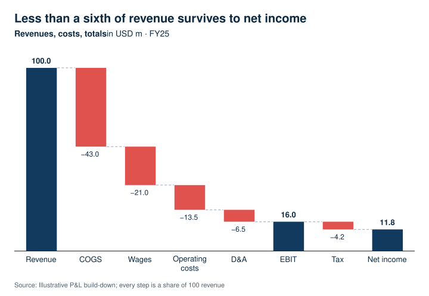

<details><summary>Spec: fixture <code>build-down</code></summary>

```json
{
  "type": "waterfall",
  "data": {
    "items": [
      { "id": "rev", "label": "Revenue", "type": "total", "value": 100 },
      { "id": "cogs", "label": "COGS", "value": -43 },
      { "id": "wages", "label": "Wages", "value": -21 },
      { "id": "opex", "label": "Operating costs", "value": -13.5 },
      { "id": "da", "label": "D&A", "value": -6.5 },
      { "id": "ebit", "label": "EBIT", "type": "subtotal" },
      { "id": "tax", "label": "Tax", "value": -4.2 },
      { "id": "net", "label": "Net income", "type": "total" }
    ]
  },
  "options": {
    "build": "down",
    "title": "Less than a sixth of revenue survives to net income",
    "subtitle": { "measure": "Revenues, costs, totals", "period": "FY25" },
    "unit": "USD m",
    "format": "1,234.0",
    "source": "Illustrative P&L build-down; every step is a share of 100 revenue"
  }
}
```

</details>

## Variance, bridges and KPIs

### kpi

Single-metric card. [Reference](reference/kpi.md)

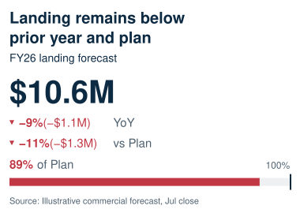

<details><summary>Spec: fixture <code>dual-compare</code></summary>

```json
{
  "type": "kpi",
  "data": {
    "label": "FY26 landing forecast",
    "value": 10600000,
    "format": "$1.1M",
    "compare": [
      { "vs": 11650000, "label": "YoY", "mode": "both" },
      { "vs": 11910000, "label": "vs Plan", "mode": "both" }
    ],
    "attainment": { "vs": 11910000, "label": "of Plan" }
  },
  "options": {
    "size": { "width": 380 },
    "title": "Landing remains below prior year and plan",
    "source": "Illustrative commercial forecast, Jul close"
  }
}
```

</details>

### variance

Variance tier against PY, PL or FC. [Reference](reference/variance.md)

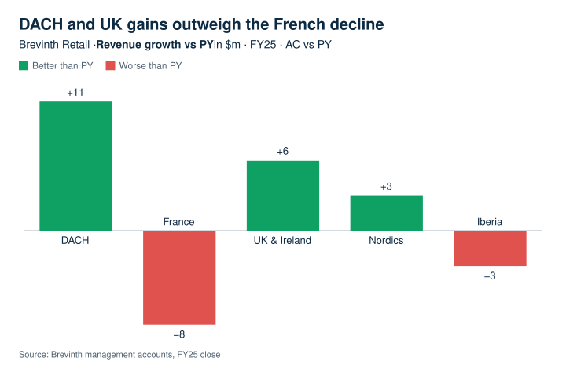

<details><summary>Spec: fixture <code>dpy-absolute-regions</code></summary>

```json
{
  "type": "variance",
  "data": {
    "categories": [
      { "id": "dach", "label": "DACH" },
      { "id": "france", "label": "France" },
      { "id": "uki", "label": "UK & Ireland" },
      { "id": "nordics", "label": "Nordics" },
      { "id": "iberia", "label": "Iberia" }
    ],
    "series": [
      { "id": "rev", "label": "Revenue", "values": [128, 96, 84, 52, 41] },
      {
        "id": "py",
        "label": "Prior year",
        "role": "reference",
        "scenario": "PY",
        "values": [117, 104, 78, 49, 44]
      }
    ]
  },
  "options": {
    "variant": "absolute",
    "variance": { "of": "rev", "vs": "py" },
    "title": "DACH and UK gains outweigh the French decline",
    "subtitle": {
      "company": "Brevinth Retail",
      "measure": "Revenue growth vs PY",
      "period": "FY25",
      "scenarios": ["AC", "PY"]
    },
    "unit": "$m",
    "source": "Brevinth management accounts, FY25 close"
  }
}
```

</details>

### bullet

KPI rows with bands and target. [Reference](reference/bullet.md)

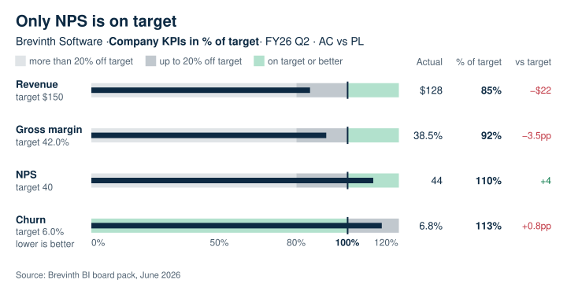

<details><summary>Spec: fixture <code>exec-kpi-panel</code></summary>

```json
{
  "type": "bullet",
  "data": {
    "rows": [
      {
        "id": "revenue",
        "label": "Revenue",
        "value": { "number": 128, "format": "$128" },
        "target": { "number": 150, "format": "$150" }
      },
      { "id": "margin", "label": "Gross margin", "value": { "pct": 38.5 }, "target": { "pct": 42 } },
      { "id": "nps", "label": "NPS", "value": 44, "target": 40 },
      {
        "id": "churn",
        "label": "Churn",
        "value": { "pct": 6.8 },
        "target": { "pct": 6 },
        "direction": "lowerIsBetter"
      }
    ]
  },
  "options": {
    "sharedScale": "percentOfTarget",
    "title": "Only NPS is on target",
    "subtitle": {
      "company": "Brevinth Software",
      "measure": "Company KPIs in % of target",
      "period": "FY26 Q2",
      "scenarios": ["AC", "PL"]
    },
    "source": "Brevinth BI board pack, June 2026"
  }
}
```

</details>

### pvm

Price, volume and mix bridge. [Reference](reference/pvm.md)

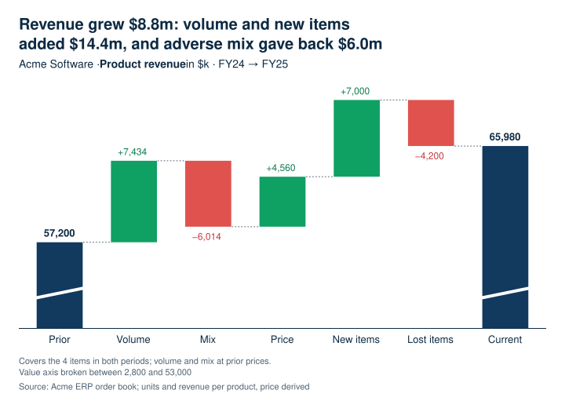

<details><summary>Spec: fixture <code>fy-revenue-bridge</code></summary>

```json
{
  "type": "pvm",
  "data": {
    "quantityUnit": "licences",
    "items": [
      {
        "id": "core",
        "label": "Core platform",
        "prior": { "qty": 1000, "revenue": 24000 },
        "current": { "qty": 1150, "revenue": 31050 }
      },
      {
        "id": "analytics",
        "label": "Analytics add-on",
        "prior": { "qty": 600, "revenue": 9000 },
        "current": { "qty": 700, "revenue": 11550 }
      },
      {
        "id": "support",
        "label": "Support plans",
        "prior": { "qty": 2000, "revenue": 8000 },
        "current": { "qty": 2400, "revenue": 10080 }
      },
      {
        "id": "legacy",
        "label": "Legacy licences",
        "prior": { "qty": 250, "revenue": 12000 },
        "current": { "qty": 140, "revenue": 6300 }
      },
      {
        "id": "assistants",
        "label": "Assistants",
        "prior": { "qty": 0, "revenue": 0 },
        "current": { "qty": 500, "revenue": 7000 }
      },
      {
        "id": "appliance",
        "label": "On-prem appliance",
        "prior": { "qty": 60, "revenue": 4200 },
        "current": { "qty": 0, "revenue": 0 }
      }
    ]
  },
  "options": {
    "size": { "width": 720, "height": 511 },
    "title": "Revenue grew $8.8m: volume and new items added $14.4m, and adverse mix gave back $6.0m",
    "subtitle": { "company": "Acme Software", "measure": "Product revenue", "period": "FY24 → FY25" },
    "unit": "$k",
    "source": "Acme ERP order book; units and revenue per product, price derived",
    "methodNote": true
  }
}
```

</details>

## Trends

### combo

Columns with line or area overlays. [Reference](reference/combo.md)

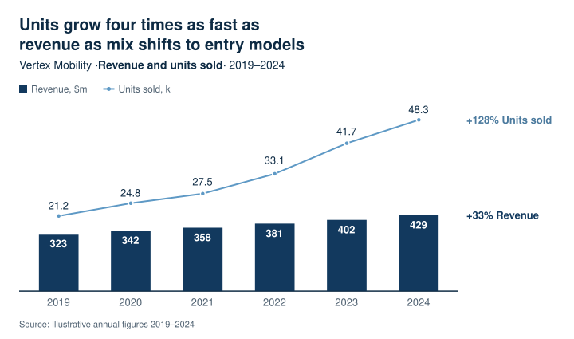

<details><summary>Spec: fixture <code>revenue-units-secondary</code></summary>

```json
{
  "type": "combo",
  "data": {
    "categories": [
      { "id": "2019", "label": "2019", "date": "2019-12-31" },
      { "id": "2020", "label": "2020", "date": "2020-12-31" },
      { "id": "2021", "label": "2021", "date": "2021-12-31" },
      { "id": "2022", "label": "2022", "date": "2022-12-31" },
      { "id": "2023", "label": "2023", "date": "2023-12-31" },
      { "id": "2024", "label": "2024", "date": "2024-12-31" }
    ],
    "series": [
      { "id": "revenue", "label": "Revenue", "values": [323, 342, 358, 381, 402, 429] },
      {
        "id": "units",
        "label": "Units sold",
        "kind": "line",
        "axis": "secondary",
        "unit": "k",
        "values": [21.2, 24.8, 27.5, 33.1, 41.7, 48.3]
      }
    ]
  },
  "options": {
    "interpolate": "linear",
    "secondaryAxis": { "acknowledge": true },
    "axisTitles": { "primary": "Revenue, $m", "secondary": "Units sold, k" },
    "title": "Units grow four times as fast as revenue as mix shifts to entry models",
    "subtitle": { "company": "Vertex Mobility", "measure": "Revenue and units sold", "period": "2019–2024" },
    "unit": "$m",
    "source": "Illustrative annual figures 2019–2024",
    "legend": "bottom",
    "dualAxis": { "anatomy": true, "growth": true }
  }
}
```

</details>

### pareto

Sorted columns with cumulative curve. [Reference](reference/pareto.md)

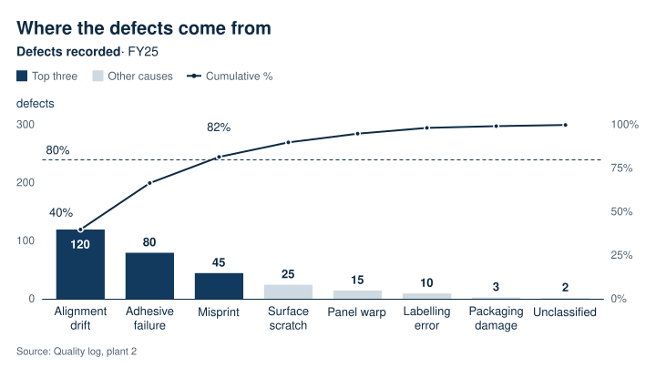

<details><summary>Spec: fixture <code>defect-causes</code></summary>

```json
{
  "type": "pareto",
  "data": {
    "items": [
      { "id": "misprint", "label": "Misprint", "value": 45 },
      { "id": "alignment", "label": "Alignment drift", "value": 120 },
      { "id": "adhesive", "label": "Adhesive failure", "value": 80 },
      { "id": "scratch", "label": "Surface scratch", "value": 25 },
      { "id": "warp", "label": "Panel warp", "value": 15 },
      { "id": "labelling", "label": "Labelling error", "value": 10 },
      { "id": "packaging", "label": "Packaging damage", "value": 3 },
      { "id": "other", "label": "Unclassified", "value": 2 }
    ]
  },
  "options": {
    "size": { "width": 720, "height": 404 },
    "title": "Where the defects come from",
    "subtitle": { "measure": "Defects recorded", "period": "FY25" },
    "totalScale": true,
    "unit": "defects",
    "source": "Quality log, plant 2",
    "strings": { "others": "Other causes" }
  }
}
```

</details>

### sparkline

One series as a mini line. [Reference](reference/sparkline.md)

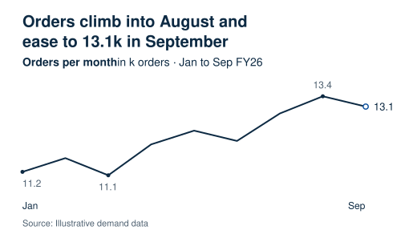

<details><summary>Spec: fixture <code>orders-nine-months</code></summary>

```json
{
  "type": "sparkline",
  "data": {
    "values": [11.2, 11.6, 11.1, 12, 12.4, 12.1, 12.9, 13.4, 13.1],
    "labels": ["Jan", "Feb", "Mar", "Apr", "May", "Jun", "Jul", "Aug", "Sep"]
  },
  "options": {
    "ring": "last",
    "endLabels": "ends",
    "valueLabel": "last",
    "format": "1.1",
    "size": { "width": 520 },
    "title": "Orders climb into August and ease to 13.1k in September",
    "subtitle": { "measure": "Orders per month", "period": "Jan to Sep FY26" },
    "source": "Illustrative demand data",
    "unit": "k orders"
  }
}
```

</details>

### slope

Two-point slope lines. [Reference](reference/slope.md)

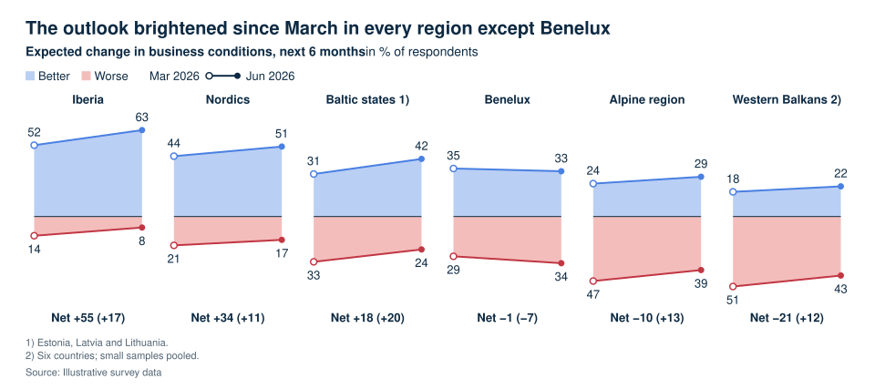

<details><summary>Spec: fixture <code>diverging-regions</code></summary>

```json
{
  "type": "slope",
  "data": {
    "categories": [{ "id": "mar", "label": "Mar 2026" }, { "id": "jun", "label": "Jun 2026" }],
    "series": [
      { "id": "nordics", "label": "Nordics", "values": [44, 51], "negative": [21, 17] },
      { "id": "iberia", "label": "Iberia", "values": [52, 63], "negative": [14, 8] },
      {
        "id": "baltics",
        "label": "Baltic states",
        "values": [31, 42],
        "negative": [33, 24],
        "footnote": 1
      },
      { "id": "alpine", "label": "Alpine region", "values": [24, 29], "negative": [47, 39] },
      { "id": "benelux", "label": "Benelux", "values": [35, 33], "negative": [29, 34] },
      {
        "id": "balkans",
        "label": "Western Balkans",
        "values": [18, 22],
        "negative": [51, 43],
        "footnote": 2
      }
    ]
  },
  "options": {
    "variant": "diverging",
    "diverging": { "labels": { "positive": "Better", "negative": "Worse" }, "sort": "positive" },
    "title": "The outlook brightened since March in every region except Benelux",
    "subtitle": { "measure": "Expected change in business conditions, next 6 months" },
    "unit": "% of respondents",
    "footnotes": ["Estonia, Latvia and Lithuania.", "Six countries; small samples pooled."],
    "source": "Illustrative survey data",
    "size": { "width": 960 }
  }
}
```

</details>

## Tables and scorecards

### bartable

Table rows with stacked bars, one panel per measure. [Reference](reference/bartable.md)

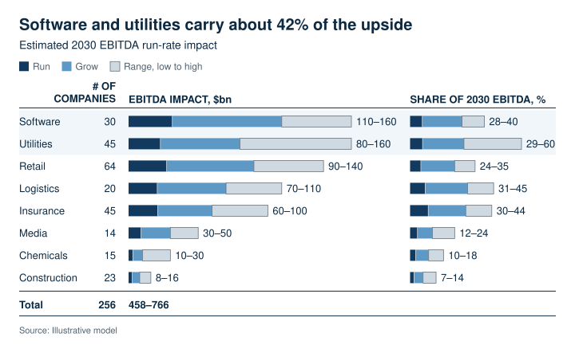

<details><summary>Spec: fixture <code>impact-two-panels-named-share</code></summary>

```json
{
  "type": "bartable",
  "data": {
    "categories": [
      { "id": "sw", "label": "Software" },
      { "id": "ut", "label": "Utilities" },
      { "id": "rt", "label": "Retail" },
      { "id": "lg", "label": "Logistics" },
      { "id": "in", "label": "Insurance" },
      { "id": "md", "label": "Media" },
      { "id": "ch", "label": "Chemicals" },
      { "id": "co", "label": "Construction" }
    ],
    "series": [{ "id": "run", "label": "Run" }, { "id": "grow", "label": "Grow" }],
    "columns": [
      {
        "id": "n",
        "label": "# of companies",
        "values": [30, 45, 64, 20, 45, 14, 15, 23],
        "format": "1,234"
      }
    ],
    "panels": [
      {
        "id": "abs",
        "label": "EBITDA impact",
        "unit": "$bn",
        "weight": 2,
        "values": { "run": [40, 30, 35, 25, 28, 12, 6, 4], "grow": [100, 75, 80, 60, 52, 28, 14, 8] },
        "ends": [
          { "low": 110, "high": 160 },
          { "low": 80, "high": 160 },
          { "low": 90, "high": 140 },
          { "low": 70, "high": 110 },
          { "low": 60, "high": 100 },
          { "low": 30, "high": 50 },
          { "low": 10, "high": 30 },
          { "low": 8, "high": 16 }
        ]
      },
      {
        "id": "pct",
        "label": "Share of 2030 EBITDA",
        "unit": "%",
        "weight": 1,
        "aggregate": "none",
        "values": { "run": [8, 9, 7, 10, 12, 6, 4, 3], "grow": [26, 30, 22, 28, 25, 12, 9, 7] },
        "ends": [
          { "low": 28, "high": 40 },
          { "low": 29, "high": 60 },
          { "low": 24, "high": 35 },
          { "low": 31, "high": 45 },
          { "low": 30, "high": 44 },
          { "low": 12, "high": 24 },
          { "low": 10, "high": 18 },
          { "low": 7, "high": 14 }
        ]
      }
    ]
  },
  "options": {
    "total": true,
    "combinedShare": { "rows": ["sw", "ut"], "label": "The two largest sectors" },
    "title": "Software and utilities carry about 42% of the upside",
    "subtitle": { "measure": "Estimated 2030 EBITDA run-rate impact" },
    "source": "Illustrative model"
  }
}
```

</details>

### status

Entity by period state matrix. [Reference](reference/status.md)

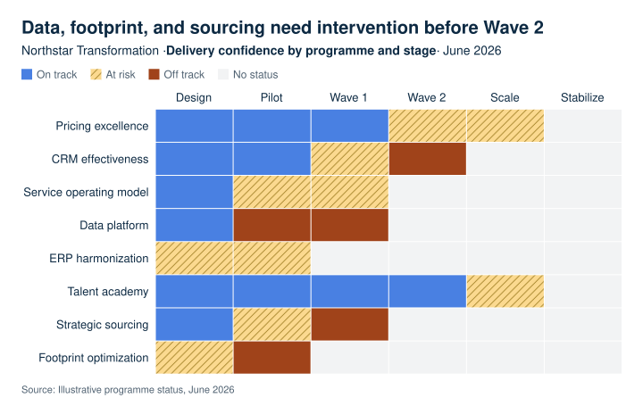

<details><summary>Spec: fixture <code>programme-rollout-rag</code></summary>

```json
{
  "type": "status",
  "data": {
    "rows": [
      { "id": "pricing", "label": "Pricing excellence" },
      { "id": "sales", "label": "CRM effectiveness" },
      { "id": "service", "label": "Service operating model" },
      { "id": "data", "label": "Data platform" },
      { "id": "erp", "label": "ERP harmonization" },
      { "id": "talent", "label": "Talent academy" },
      { "id": "sourcing", "label": "Strategic sourcing" },
      { "id": "footprint", "label": "Footprint optimization" }
    ],
    "columns": [
      { "id": "design", "label": "Design" },
      { "id": "pilot", "label": "Pilot" },
      { "id": "wave-1", "label": "Wave 1" },
      { "id": "wave-2", "label": "Wave 2" },
      { "id": "scale", "label": "Scale" },
      { "id": "stabilize", "label": "Stabilize" }
    ],
    "cells": [
      { "row": "pricing", "col": "design", "state": "green" },
      { "row": "pricing", "col": "pilot", "state": "green" },
      { "row": "pricing", "col": "wave-1", "state": "green" },
      { "row": "pricing", "col": "wave-2", "state": "amber" },
      { "row": "pricing", "col": "scale", "state": "amber" },
      { "row": "sales", "col": "design", "state": "green" },
      { "row": "sales", "col": "pilot", "state": "green" },
      { "row": "sales", "col": "wave-1", "state": "amber" },
      { "row": "sales", "col": "wave-2", "state": "red" },
      { "row": "service", "col": "design", "state": "green" },
      { "row": "service", "col": "pilot", "state": "amber" },
      { "row": "service", "col": "wave-1", "state": "amber" },
      { "row": "data", "col": "design", "state": "green" },
      { "row": "data", "col": "pilot", "state": "red" },
      { "row": "data", "col": "wave-1", "state": "red" },
      { "row": "erp", "col": "design", "state": "amber" },
      { "row": "erp", "col": "pilot", "state": "amber" },
      { "row": "talent", "col": "design", "state": "green" },
      { "row": "talent", "col": "pilot", "state": "green" },
      { "row": "talent", "col": "wave-1", "state": "green" },
      { "row": "talent", "col": "wave-2", "state": "green" },
      { "row": "talent", "col": "scale", "state": "amber" },
      { "row": "sourcing", "col": "design", "state": "green" },
      { "row": "sourcing", "col": "pilot", "state": "amber" },
      { "row": "sourcing", "col": "wave-1", "state": "red" },
      { "row": "footprint", "col": "design", "state": "amber" },
      { "row": "footprint", "col": "pilot", "state": "red" }
    ]
  },
  "options": {
    "states": [
      { "id": "green", "label": "On track", "tone": "good" },
      { "id": "amber", "label": "At risk", "tone": "warn", "pattern": "hatch45" },
      { "id": "red", "label": "Off track", "tone": "bad" }
    ],
    "colorblindSafe": true,
    "title": "Data, footprint, and sourcing need intervention before Wave 2",
    "subtitle": {
      "company": "Northstar Transformation",
      "measure": "Delivery confidence by programme and stage",
      "period": "June 2026"
    },
    "source": "Illustrative programme status, June 2026"
  }
}
```

</details>

### heatmap

Row by column matrix. [Reference](reference/heatmap.md)

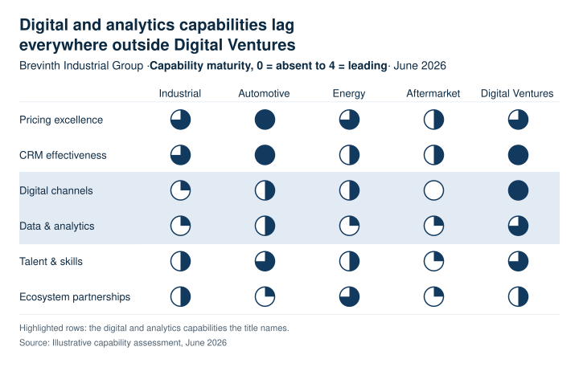

<details><summary>Spec: fixture <code>capability-matrix</code></summary>

```json
{
  "type": "heatmap",
  "data": {
    "categories": [
      { "id": "industrial", "label": "Industrial" },
      { "id": "automotive", "label": "Automotive" },
      { "id": "energy", "label": "Energy" },
      { "id": "aftermarket", "label": "Aftermarket" },
      { "id": "digital-bu", "label": "Digital Ventures" }
    ],
    "series": [
      { "id": "pricing", "label": "Pricing excellence", "values": [3, 4, 3, 2, 3] },
      { "id": "crm", "label": "CRM effectiveness", "values": [3, 4, 2, 2, 4] },
      { "id": "digital-channels", "label": "Digital channels", "values": [1, 2, 2, 0, 4] },
      { "id": "data-analytics", "label": "Data & analytics", "values": [1, 2, 1, 1, 3] },
      { "id": "talent", "label": "Talent & skills", "values": [2, 3, 2, 1, 3] },
      { "id": "partnerships", "label": "Ecosystem partnerships", "values": [2, 1, 3, 1, 2] }
    ]
  },
  "options": {
    "variant": "harvey",
    "scale": "discrete",
    "title": "Digital and analytics capabilities lag everywhere outside Digital Ventures",
    "subtitle": {
      "company": "Brevinth Industrial Group",
      "measure": "Capability maturity, 0 = absent to 4 = leading",
      "period": "June 2026"
    },
    "source": "Illustrative capability assessment, June 2026",
    "highlight": ["digital-channels", "data-analytics"],
    "footnotes": ["Shaded rows: the digital and analytics capabilities the title names."]
  }
}
```

</details>

### cohort

Retention by cohort and period. [Reference](reference/cohort.md)

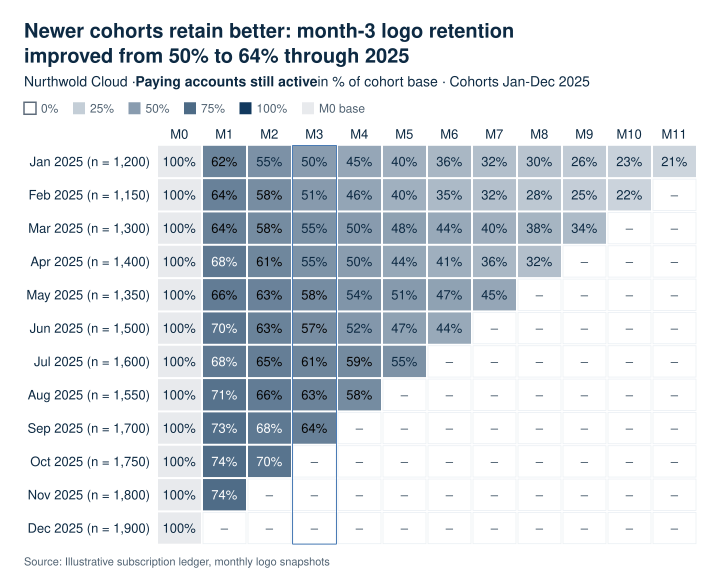

<details><summary>Spec: fixture <code>saas-logo-retention</code></summary>

```json
{
  "type": "cohort",
  "data": {
    "periodLabel": "Month",
    "cohorts": [
      {
        "id": "c01",
        "label": "Jan 2025",
        "active": [1200, 748, 664, 600, 539, 478, 437, 388, 355, 315, 279, 255]
      },
      {
        "id": "c02",
        "label": "Feb 2025",
        "active": [1150, 732, 662, 584, 524, 460, 403, 364, 319, 288, 253]
      },
      {
        "id": "c03",
        "label": "Mar 2025",
        "active": [1300, 828, 758, 711, 655, 618, 566, 518, 489, 448]
      },
      { "id": "c04", "label": "Apr 2025", "active": [1400, 953, 849, 765, 694, 618, 567, 505, 450] },
      { "id": "c05", "label": "May 2025", "active": [1350, 892, 849, 784, 724, 689, 637, 606] },
      { "id": "c06", "label": "Jun 2025", "active": [1500, 1045, 940, 862, 785, 706, 655] },
      { "id": "c07", "label": "Jul 2025", "active": [1600, 1080, 1041, 981, 940, 880] },
      { "id": "c08", "label": "Aug 2025", "active": [1550, 1106, 1024, 971, 904] },
      { "id": "c09", "label": "Sep 2025", "active": [1700, 1239, 1154, 1088] },
      { "id": "c10", "label": "Oct 2025", "active": [1750, 1299, 1232] },
      { "id": "c11", "label": "Nov 2025", "active": [1800, 1338] },
      { "id": "c12", "label": "Dec 2025", "active": [1900] }
    ]
  },
  "options": {
    "size": { "width": 720, "height": 580 },
    "title": "Newer cohorts retain better: month-3 logo retention improved from 50% to 64% through 2025",
    "subtitle": {
      "company": "Nurthwold Cloud",
      "measure": "Paying accounts still active",
      "period": "Cohorts Jan-Dec 2025"
    },
    "unit": "% of cohort base",
    "source": "Illustrative subscription ledger, monthly logo snapshots",
    "highlight": "t3"
  }
}
```

</details>

## Composition

### pie

Pie or doughnut of shares. [Reference](reference/pie.md)

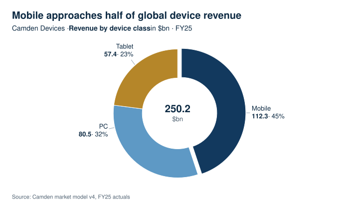

<details><summary>Spec: fixture <code>doughnut-device-revenue</code></summary>

```json
{
  "type": "pie",
  "data": {
    "categories": [
      { "id": "mobile", "label": "Mobile" },
      { "id": "pc", "label": "PC" },
      { "id": "tablet", "label": "Tablet" }
    ],
    "series": [{ "id": "rev", "label": "Device revenue", "values": [112.3, 80.5, 57.4] }]
  },
  "options": {
    "doughnut": 0.55,
    "explode": { "mobile": 0.06 },
    "colors": "categorical",
    "format": "1,234.5",
    "title": "Mobile approaches half of global device revenue",
    "subtitle": { "company": "Camden Devices", "measure": "Revenue by device class", "period": "FY25" },
    "unit": "$bn",
    "source": "Camden market model v4, FY25 actuals"
  }
}
```

</details>

### funnel

Stage funnel with conversion rates. [Reference](reference/funnel.md)

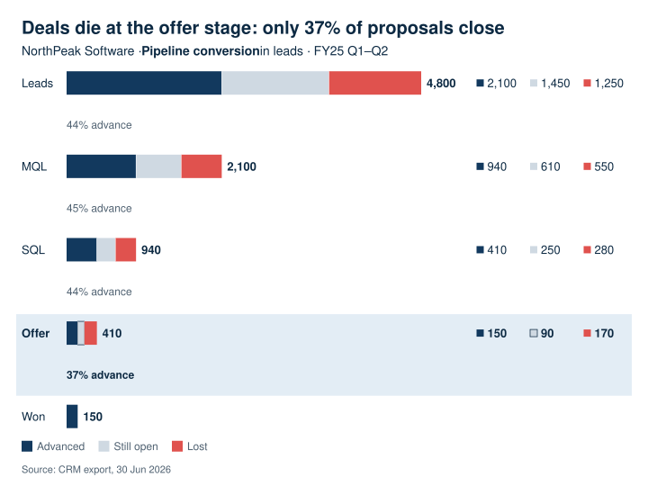

<details><summary>Spec: fixture <code>lead-funnel</code></summary>

```json
{
  "type": "funnel",
  "data": {
    "categories": [
      { "id": "leads", "label": "Leads" },
      { "id": "mql", "label": "MQL" },
      { "id": "sql", "label": "SQL" },
      { "id": "offer", "label": "Offer" },
      { "id": "won", "label": "Won" }
    ],
    "series": [
      {
        "id": "advanced",
        "label": "Advanced",
        "colorRole": "series-1",
        "values": [2100, 940, 410, 150, 150]
      },
      {
        "id": "open",
        "label": "Still open",
        "colorRole": "neutralLight",
        "values": [1450, 610, 250, 90, 0]
      },
      {
        "id": "lost",
        "label": "Lost",
        "colorRole": "status-lost",
        "values": [1250, 550, 280, 170, 0]
      }
    ]
  },
  "options": {
    "variant": "rows",
    "title": "Deals die at the offer stage: only 37% of proposals close",
    "subtitle": { "company": "NorthPeak Software", "measure": "Pipeline conversion", "period": "FY25 Q1–Q2" },
    "unit": "leads",
    "source": "CRM export, 30 Jun 2026",
    "legend": "bottom",
    "size": "slide-4x3",
    "highlight": ["offer"]
  }
}
```

</details>

### mekko

Variable-width stacked columns. [Reference](reference/mekko.md)

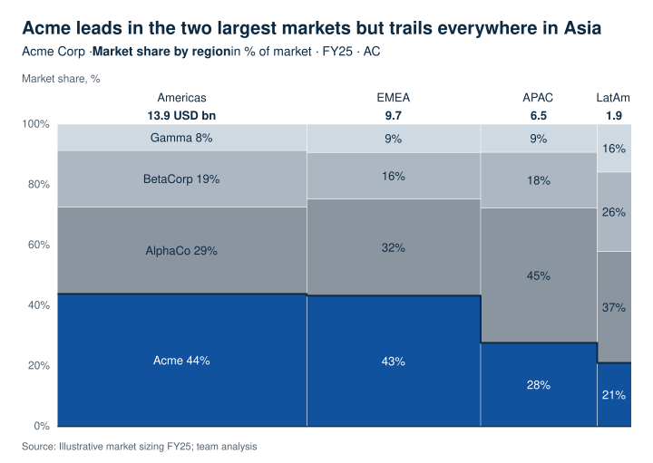

<details><summary>Spec: fixture <code>stacked100-market-map</code></summary>

```json
{
  "type": "mekko",
  "data": {
    "categories": [
      { "id": "americas", "label": "Americas" },
      { "id": "emea", "label": "EMEA" },
      { "id": "apac", "label": "APAC" },
      { "id": "latam", "label": "LatAm" }
    ],
    "series": [
      {
        "id": "acme",
        "label": "Acme",
        "colorRole": "highlight",
        "unit": "USD bn",
        "values": [6.1, 4.2, 1.8, 0.4]
      },
      { "id": "alpha", "label": "AlphaCo", "unit": "USD bn", "values": [4, 3.1, 2.9, 0.7] },
      { "id": "beta", "label": "BetaCorp", "unit": "USD bn", "values": [2.6, 1.5, 1.2, 0.5] },
      { "id": "gamma", "label": "Gamma", "unit": "USD bn", "values": [1.2, 0.9, 0.6, 0.3] }
    ]
  },
  "options": {
    "variant": "stacked100",
    "ridge": "acme",
    "highlight": "acme",
    "title": "Acme leads in the two largest markets but trails everywhere in Asia",
    "subtitle": {
      "company": "Acme Corp",
      "measure": "Market share by region",
      "period": "FY25",
      "scenarios": ["AC"]
    },
    "unit": "% of market",
    "axisTitles": { "primary": "Market share, %" },
    "size": { "width": 720, "height": 511 },
    "source": "Illustrative market sizing FY25; team analysis",
    "rounding": "sum-consistent"
  }
}
```

</details>

### treemap

Part of a whole as nested areas. [Reference](reference/treemap.md)

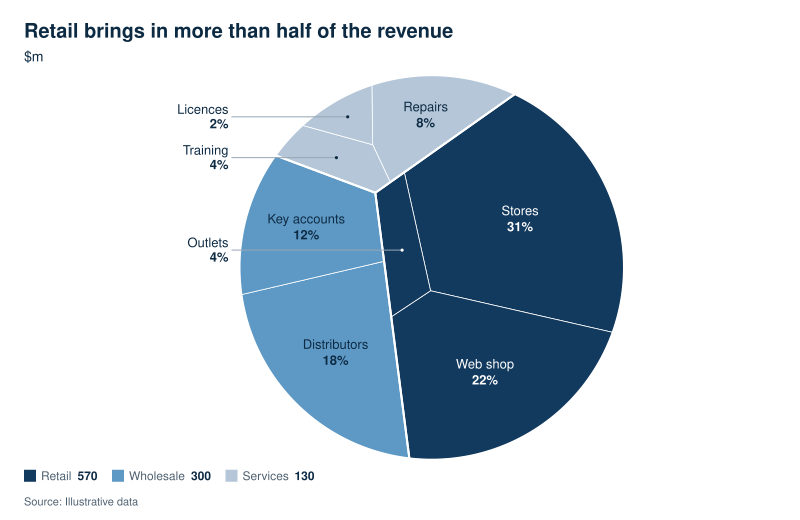

<details><summary>Spec: fixture <code>source-order-shares-circle</code></summary>

```json
{
  "type": "treemap",
  "data": {
    "groups": [
      { "id": "retail", "label": "Retail" },
      { "id": "wholesale", "label": "Wholesale" },
      { "id": "services", "label": "Services" }
    ],
    "items": [
      { "id": "stores", "label": "Stores", "group": "retail", "value": 310 },
      { "id": "web-shop", "label": "Web shop", "group": "retail", "value": 220 },
      { "id": "outlets", "label": "Outlets", "group": "retail", "value": 40 },
      { "id": "distributors", "label": "Distributors", "group": "wholesale", "value": 180 },
      { "id": "key-accounts", "label": "Key accounts", "group": "wholesale", "value": 120 },
      { "id": "repairs", "label": "Repairs", "group": "services", "value": 75 },
      { "id": "training", "label": "Training", "group": "services", "value": 35 },
      { "id": "licences", "label": "Licences", "group": "services", "value": 20 }
    ]
  },
  "options": {
    "title": "Retail brings in more than half of the revenue",
    "unit": "$m",
    "source": "Illustrative data",
    "variant": "circle",
    "order": "sheet",
    "cellValue": "share",
    "legend": "bottom",
    "size": { "width": 800, "height": 520 }
  }
}
```

</details>

### waffle

Share of a whole as a grid of cells. [Reference](reference/waffle.md)

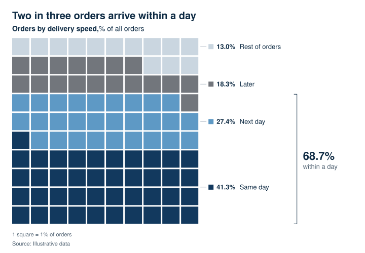

<details><summary>Spec: fixture <code>stacked-segments</code></summary>

```json
{
  "type": "waffle",
  "data": {
    "categories": [{ "id": "orders", "label": "Orders by delivery speed, % of all orders" }],
    "series": [
      { "id": "same-day", "label": "Same day", "values": [41.3] },
      { "id": "next-day", "label": "Next day", "values": [27.4] },
      { "id": "later", "label": "Later", "colorRole": "series-4", "values": [18.3] }
    ]
  },
  "options": {
    "title": "Two in three orders arrive within a day",
    "source": "Illustrative data",
    "format": "0.0%",
    "variant": "cells",
    "subtotal": { "series": ["same-day", "next-day"], "label": "within a day" },
    "strings": { "others": "Rest of orders" },
    "footnotes": ["1 square = 1% of orders"]
  }
}
```

</details>

### sankey

Flows from sources to targets in stages. [Reference](reference/sankey.md)

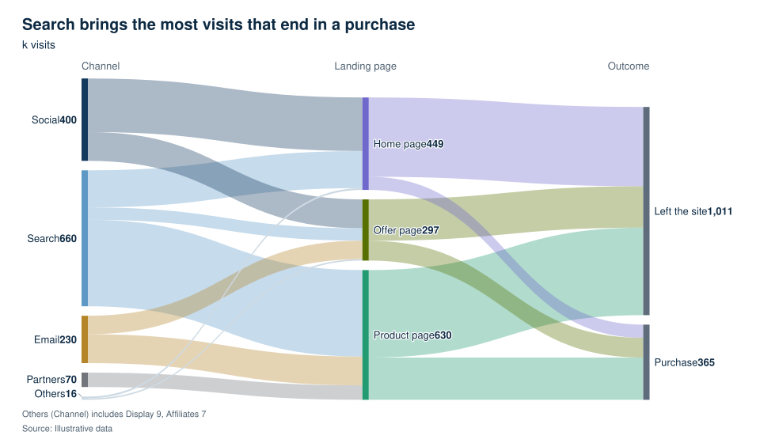

<details><summary>Spec: fixture <code>channel-journeys</code></summary>

```json
{
  "type": "sankey",
  "data": {
    "links": [
      { "source": "search", "target": "product", "value": 420 },
      { "source": "search", "target": "home", "value": 180 },
      { "source": "search", "target": "offer", "value": 60 },
      { "source": "social", "target": "home", "value": 260 },
      { "source": "social", "target": "offer", "value": 140 },
      { "source": "email", "target": "product", "value": 140 },
      { "source": "email", "target": "offer", "value": 90 },
      { "source": "partners", "target": "product", "value": 70 },
      { "source": "display", "target": "home", "value": 9 },
      { "source": "affiliates", "target": "offer", "value": 7 },
      { "source": "product", "target": "purchase", "value": 205 },
      { "source": "product", "target": "exit", "value": 425 },
      { "source": "home", "target": "purchase", "value": 64 },
      { "source": "home", "target": "exit", "value": 385 },
      { "source": "offer", "target": "purchase", "value": 96 },
      { "source": "offer", "target": "exit", "value": 201 }
    ],
    "nodes": [
      { "id": "search", "label": "Search" },
      { "id": "social", "label": "Social" },
      { "id": "email", "label": "Email" },
      { "id": "partners", "label": "Partners" },
      { "id": "display", "label": "Display" },
      { "id": "affiliates", "label": "Affiliates" },
      { "id": "product", "label": "Product page" },
      { "id": "home", "label": "Home page" },
      { "id": "offer", "label": "Offer page" },
      { "id": "purchase", "label": "Purchase" },
      { "id": "exit", "label": "Left the site" }
    ],
    "stages": [
      { "id": "channel", "label": "Channel" },
      { "id": "page", "label": "Landing page" },
      { "id": "outcome", "label": "Outcome" }
    ]
  },
  "options": {
    "title": "Search brings the most visits that end in a purchase",
    "source": "Illustrative data",
    "unit": "k visits",
    "notes": { "show": ["note", "disclosure"] },
    "size": { "width": 960, "height": 560 }
  }
}
```

</details>

## Plans and structure

### gantt

Timeline with spans and events. [Reference](reference/gantt.md)

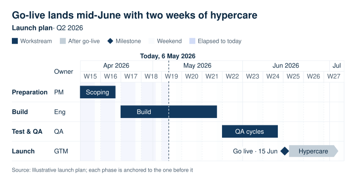

<details><summary>Spec: fixture <code>product-launch</code></summary>

```json
{
  "type": "gantt",
  "data": {
    "rows": [
      {
        "id": "prep",
        "label": "Preparation",
        "cols": ["PM"],
        "items": [
          {
            "id": "prep-scope",
            "kind": "bar",
            "start": "2026-04-06",
            "end": "2026-04-17",
            "label": "Scoping"
          }
        ]
      },
      {
        "id": "build",
        "label": "Build",
        "cols": ["Eng"],
        "items": [
          {
            "id": "build-dev",
            "kind": "bar",
            "start": "2026-04-20",
            "end": "2026-05-22",
            "label": "Build",
            "anchor": { "toItemId": "prep-scope", "edge": "end", "offsetDays": 2 }
          }
        ]
      },
      {
        "id": "test",
        "label": "Test & QA",
        "cols": ["QA"],
        "items": [
          {
            "id": "test-qa",
            "kind": "bar",
            "start": "2026-05-25",
            "end": "2026-06-12",
            "label": "QA cycles",
            "anchor": { "toItemId": "build-dev", "edge": "end", "offsetDays": 2 }
          }
        ]
      },
      {
        "id": "launch",
        "label": "Launch",
        "cols": ["GTM"],
        "items": [
          {
            "id": "launch-go",
            "kind": "milestone",
            "start": "2026-06-15",
            "label": "Go live",
            "anchor": { "toItemId": "test-qa", "edge": "end", "offsetDays": 2 }
          },
          {
            "id": "hypercare",
            "kind": "chevron",
            "start": "2026-06-17",
            "end": "2026-07-03",
            "label": "Hypercare",
            "colorRole": "neutralLight",
            "colorLabel": "After go-live",
            "anchor": { "toItemId": "launch-go", "edge": "end", "offsetDays": 1 }
          }
        ]
      }
    ]
  },
  "options": {
    "title": "Go-live lands mid-June with two weeks of hypercare",
    "subtitle": { "measure": "Launch plan", "period": "Q2 2026" },
    "colHeaders": ["Owner"],
    "source": "Illustrative launch plan; each phase is anchored to the one before it",
    "today": "2026-05-06",
    "weekends": true
  }
}
```

</details>

### grid

Facets and metric stacks on one category axis. [Reference](reference/grid.md)

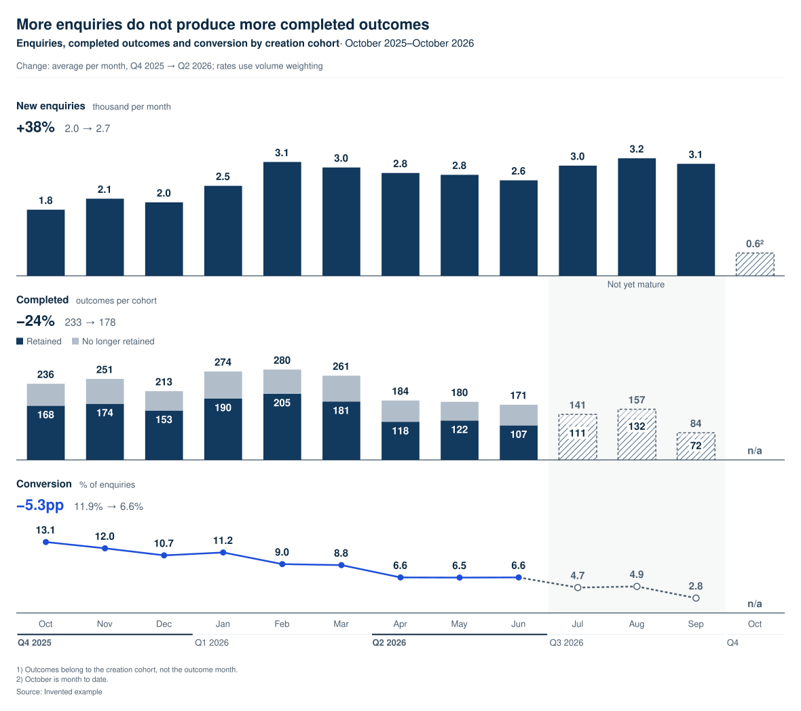

<details><summary>Spec: fixture <code>metric-stack-volume</code></summary>

```json
{
  "type": "grid",
  "data": {
    "categories": [
      { "id": "2025-10", "label": "Oct" },
      { "id": "2025-11", "label": "Nov" },
      { "id": "2025-12", "label": "Dec" },
      { "id": "2026-01", "label": "Jan" },
      { "id": "2026-02", "label": "Feb" },
      { "id": "2026-03", "label": "Mar" },
      { "id": "2026-04", "label": "Apr" },
      { "id": "2026-05", "label": "May" },
      { "id": "2026-06", "label": "Jun" },
      { "id": "2026-07", "label": "Jul" },
      { "id": "2026-08", "label": "Aug" },
      { "id": "2026-09", "label": "Sep" },
      { "id": "2026-10", "label": "Oct", "partial": true }
    ],
    "measures": [
      {
        "id": "intake",
        "label": "Intake",
        "values": [1800, 2100, 2000, 2450, 3100, 2950, 2800, 2750, 2600, 3000, 3200, 3050, 620]
      },
      {
        "id": "retained",
        "label": "Retained",
        "values": [168, 174, 153, 190, 205, 181, 118, 122, 107, 111, 132, 72, null]
      },
      {
        "id": "ended",
        "label": "No longer retained",
        "values": [68, 77, 60, 84, 75, 80, 66, 58, 64, 30, 25, 12, null]
      }
    ],
    "panels": [
      {
        "id": "intake",
        "type": "column",
        "title": "New enquiries",
        "unit": "thousand per month",
        "measure": { "sum": ["intake"] },
        "divisor": 1000,
        "decimals": 1,
        "readout": "change"
      },
      {
        "id": "completed",
        "type": "column",
        "title": "Completed",
        "unit": "outcomes per cohort",
        "measure": { "sum": ["retained", "ended"] },
        "readout": "change"
      },
      {
        "id": "conversion",
        "type": "line",
        "title": "Conversion",
        "unit": "% of enquiries",
        "measure": { "numerator": ["retained", "ended"], "denominator": "intake" },
        "readout": "change",
        "emphasis": true
      }
    ],
    "states": {
      "maturing": { "from": "2026-07", "to": "2026-09", "panels": ["completed", "conversion"] },
      "partial": { "panels": ["completed", "conversion"], "footnote": "October is month to date." }
    },
    "windows": {
      "grain": "month",
      "base": { "from": "2025-10", "to": "2025-12", "label": "Q4 2025" },
      "compare": { "from": "2026-04", "to": "2026-06", "label": "Q2 2026" }
    },
    "periods": [
      { "from": "2025-10", "to": "2025-12", "label": "Q4 2025" },
      { "from": "2026-01", "to": "2026-03", "label": "Q1 2026" },
      { "from": "2026-04", "to": "2026-06", "label": "Q2 2026" },
      { "from": "2026-07", "to": "2026-09", "label": "Q3 2026" },
      { "from": "2026-10", "to": "2026-10", "label": "Q4" }
    ]
  },
  "options": {
    "stack": { "heights": [200, 160, 140] },
    "sharedAxis": "category",
    "size": { "width": 1180 },
    "title": "More enquiries do not produce more completed outcomes",
    "subtitle": {
      "measure": "Enquiries, completed outcomes and conversion by creation cohort",
      "period": "October 2025–October 2026"
    },
    "footnotes": ["Outcomes belong to the creation cohort, not the outcome month."],
    "source": "Invented example"
  }
}
```

</details>

### diagram

Node and edge diagrams. [Reference](reference/diagram.md)

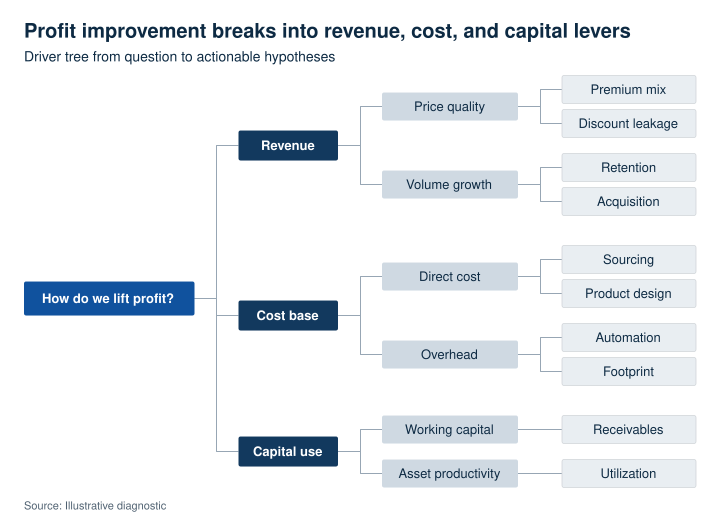

<details><summary>Spec: fixture <code>profit-issue-tree</code></summary>

```json
{
  "type": "diagram",
  "data": {
    "nodes": [
      {
        "id": "profit",
        "kind": "issue",
        "shape": { "kind": "roundedRect" },
        "label": "How do we lift profit?",
        "role": "accent"
      },
      {
        "id": "revenue",
        "kind": "driver",
        "shape": { "kind": "roundedRect" },
        "label": "Revenue",
        "role": "primary",
        "order": 1
      },
      {
        "id": "cost",
        "kind": "driver",
        "shape": { "kind": "roundedRect" },
        "label": "Cost base",
        "role": "primary",
        "order": 2
      },
      {
        "id": "capital",
        "kind": "driver",
        "shape": { "kind": "roundedRect" },
        "label": "Capital use",
        "role": "primary",
        "order": 3
      },
      {
        "id": "price",
        "kind": "driver",
        "shape": { "kind": "roundedRect" },
        "label": "Price quality",
        "role": "secondary",
        "order": 1
      },
      {
        "id": "volume",
        "kind": "driver",
        "shape": { "kind": "roundedRect" },
        "label": "Volume growth",
        "role": "secondary",
        "order": 2
      },
      {
        "id": "direct",
        "kind": "driver",
        "shape": { "kind": "roundedRect" },
        "label": "Direct cost",
        "role": "secondary",
        "order": 3
      },
      {
        "id": "overhead",
        "kind": "driver",
        "shape": { "kind": "roundedRect" },
        "label": "Overhead",
        "role": "secondary",
        "order": 4
      },
      {
        "id": "working-capital",
        "kind": "driver",
        "shape": { "kind": "roundedRect" },
        "label": "Working capital",
        "role": "secondary",
        "order": 5
      },
      {
        "id": "asset-use",
        "kind": "driver",
        "shape": { "kind": "roundedRect" },
        "label": "Asset productivity",
        "role": "secondary",
        "order": 6
      },
      {
        "id": "mix",
        "kind": "driver",
        "shape": { "kind": "roundedRect" },
        "label": "Premium mix",
        "role": "muted",
        "order": 1
      },
      {
        "id": "discount-leakage",
        "kind": "driver",
        "shape": { "kind": "roundedRect" },
        "label": "Discount leakage",
        "role": "muted",
        "order": 2
      },
      {
        "id": "retention",
        "kind": "driver",
        "shape": { "kind": "roundedRect" },
        "label": "Retention",
        "role": "muted",
        "order": 3
      },
      {
        "id": "acquisition",
        "kind": "driver",
        "shape": { "kind": "roundedRect" },
        "label": "Acquisition",
        "role": "muted",
        "order": 4
      },
      {
        "id": "sourcing",
        "kind": "driver",
        "shape": { "kind": "roundedRect" },
        "label": "Sourcing",
        "role": "muted",
        "order": 5
      },
      {
        "id": "product-design",
        "kind": "driver",
        "shape": { "kind": "roundedRect" },
        "label": "Product design",
        "role": "muted",
        "order": 6
      },
      {
        "id": "automation",
        "kind": "driver",
        "shape": { "kind": "roundedRect" },
        "label": "Automation",
        "role": "muted",
        "order": 7
      },
      {
        "id": "footprint",
        "kind": "driver",
        "shape": { "kind": "roundedRect" },
        "label": "Footprint",
        "role": "muted",
        "order": 8
      },
      {
        "id": "receivables",
        "kind": "driver",
        "shape": { "kind": "roundedRect" },
        "label": "Receivables",
        "role": "muted",
        "order": 9
      },
      {
        "id": "utilization",
        "kind": "driver",
        "shape": { "kind": "roundedRect" },
        "label": "Utilization",
        "role": "muted",
        "order": 10
      }
    ],
    "edges": [
      {
        "id": "profit-revenue",
        "source": { "nodeId": "profit" },
        "target": { "nodeId": "revenue" }
      },
      { "id": "profit-cost", "source": { "nodeId": "profit" }, "target": { "nodeId": "cost" } },
      {
        "id": "profit-capital",
        "source": { "nodeId": "profit" },
        "target": { "nodeId": "capital" }
      },
      { "id": "revenue-price", "source": { "nodeId": "revenue" }, "target": { "nodeId": "price" } },
      {
        "id": "revenue-volume",
        "source": { "nodeId": "revenue" },
        "target": { "nodeId": "volume" }
      },
      { "id": "cost-direct", "source": { "nodeId": "cost" }, "target": { "nodeId": "direct" } },
      { "id": "cost-overhead", "source": { "nodeId": "cost" }, "target": { "nodeId": "overhead" } },
      {
        "id": "capital-working",
        "source": { "nodeId": "capital" },
        "target": { "nodeId": "working-capital" }
      },
      {
        "id": "capital-asset-use",
        "source": { "nodeId": "capital" },
        "target": { "nodeId": "asset-use" }
      },
      { "id": "price-mix", "source": { "nodeId": "price" }, "target": { "nodeId": "mix" } },
      {
        "id": "price-discount",
        "source": { "nodeId": "price" },
        "target": { "nodeId": "discount-leakage" }
      },
      {
        "id": "volume-retention",
        "source": { "nodeId": "volume" },
        "target": { "nodeId": "retention" }
      },
      {
        "id": "volume-acquisition",
        "source": { "nodeId": "volume" },
        "target": { "nodeId": "acquisition" }
      },
      {
        "id": "direct-sourcing",
        "source": { "nodeId": "direct" },
        "target": { "nodeId": "sourcing" }
      },
      {
        "id": "direct-product-design",
        "source": { "nodeId": "direct" },
        "target": { "nodeId": "product-design" }
      },
      {
        "id": "overhead-automation",
        "source": { "nodeId": "overhead" },
        "target": { "nodeId": "automation" }
      },
      {
        "id": "overhead-footprint",
        "source": { "nodeId": "overhead" },
        "target": { "nodeId": "footprint" }
      },
      {
        "id": "working-receivables",
        "source": { "nodeId": "working-capital" },
        "target": { "nodeId": "receivables" }
      },
      {
        "id": "asset-utilization",
        "source": { "nodeId": "asset-use" },
        "target": { "nodeId": "utilization" }
      }
    ]
  },
  "options": {
    "variant": "issue-tree",
    "title": "Profit improvement breaks into revenue, cost, and capital levers",
    "subtitle": "Driver tree from question to actionable hypotheses",
    "source": "Illustrative diagnostic"
  }
}
```

</details>

## Distribution and ranking

### scatter

XY/bubble. [Reference](reference/scatter.md)

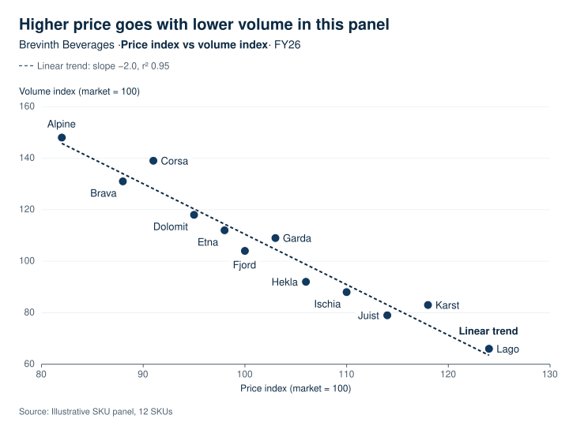

<details><summary>Spec: fixture <code>price-volume-trend</code></summary>

```json
{
  "type": "scatter",
  "data": {
    "points": [
      { "id": "alpine", "label": "Alpine", "x": 82, "y": 148 },
      { "id": "brava", "label": "Brava", "x": 88, "y": 131 },
      { "id": "corsa", "label": "Corsa", "x": 91, "y": 139 },
      { "id": "dolomit", "label": "Dolomit", "x": 95, "y": 118 },
      { "id": "etna", "label": "Etna", "x": 98, "y": 112 },
      { "id": "fjord", "label": "Fjord", "x": 100, "y": 104 },
      { "id": "garda", "label": "Garda", "x": 103, "y": 109 },
      { "id": "hekla", "label": "Hekla", "x": 106, "y": 92 },
      { "id": "ischia", "label": "Ischia", "x": 110, "y": 88 },
      { "id": "juist", "label": "Juist", "x": 114, "y": 79 },
      { "id": "karst", "label": "Karst", "x": 118, "y": 83 },
      { "id": "lago", "label": "Lago", "x": 124, "y": 66 }
    ]
  },
  "options": {
    "title": "Higher price goes with lower volume in this panel",
    "subtitle": { "company": "Brevinth Beverages", "measure": "Price index vs volume index", "period": "FY26" },
    "axisTitles": { "x": "Price index (market = 100)", "y": "Volume index (market = 100)" },
    "trend": { "label": "Linear trend" },
    "source": "Illustrative SKU panel, 12 SKUs"
  }
}
```

</details>

### dot

Dots, dumbbells or lollipops. [Reference](reference/dot.md)

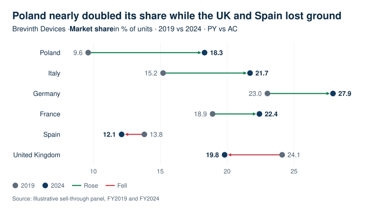

<details><summary>Spec: fixture <code>share-shift-arrow</code></summary>

```json
{
  "type": "dot",
  "data": {
    "categories": [
      { "id": "de", "label": "Germany" },
      { "id": "fr", "label": "France" },
      { "id": "uk", "label": "United Kingdom" },
      { "id": "it", "label": "Italy" },
      { "id": "es", "label": "Spain" },
      { "id": "pl", "label": "Poland" }
    ],
    "series": [
      {
        "id": "y2019",
        "label": "2019",
        "scenario": "PY",
        "values": [23, 18.9, 24.1, 15.2, 13.8, 9.6]
      },
      {
        "id": "y2024",
        "label": "2024",
        "scenario": "AC",
        "direction": "higherIsBetter",
        "values": [27.9, 22.4, 19.8, 21.7, 12.1, 18.3]
      }
    ]
  },
  "options": {
    "variant": "dumbbell",
    "arrow": true,
    "title": "Poland nearly doubled its share while the UK and Spain lost ground",
    "subtitle": {
      "company": "Brevinth Devices",
      "measure": "Market share",
      "period": "2019 vs 2024",
      "scenarios": ["PY", "AC"]
    },
    "unit": "% of units",
    "source": "Illustrative sell-through panel, FY2019 and FY2024",
    "sort": { "categories": "desc" },
    "legend": "bottom"
  }
}
```

</details>

### butterfly

Two mirrored bar panes. [Reference](reference/butterfly.md)

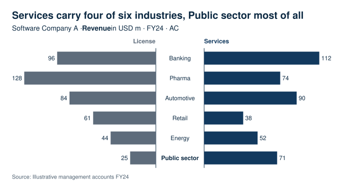

<details><summary>Spec: fixture <code>license-vs-services</code></summary>

```json
{
  "type": "butterfly",
  "data": {
    "categories": [
      { "id": "pharma", "label": "Pharma" },
      { "id": "banking", "label": "Banking" },
      { "id": "auto", "label": "Automotive" },
      { "id": "retail", "label": "Retail" },
      { "id": "energy", "label": "Energy" },
      { "id": "public", "label": "Public sector" }
    ],
    "series": [
      { "id": "license", "label": "License", "values": [128, 96, 84, 61, 44, 25] },
      { "id": "services", "label": "Services", "values": [74, 112, 90, 38, 52, 71] }
    ]
  },
  "options": {
    "a": "license",
    "b": "services",
    "sortBy": "sum",
    "highlight": ["public"],
    "title": "Services carry four of six industries, Public sector most of all",
    "subtitle": { "company": "Software Company A", "measure": "Revenue", "period": "FY24", "scenarios": ["AC"] },
    "unit": "USD m",
    "source": "Illustrative management accounts FY24"
  }
}
```

</details>

### histogram

Equal-width bins of raw values. [Reference](reference/histogram.md)

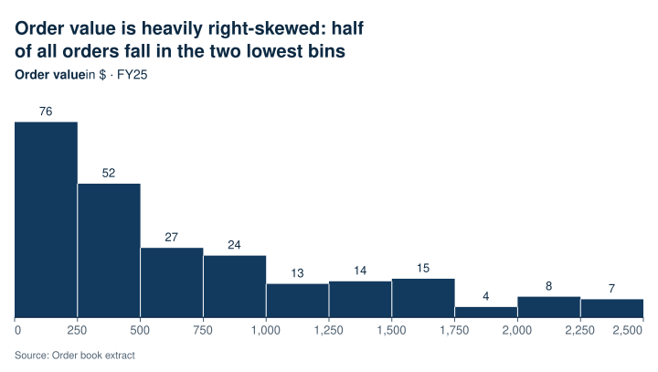

<details><summary>Spec: fixture <code>order-value-distribution</code></summary>

```json
{
  "type": "histogram",
  "data": {
    "observations": [
      226,
      223,
      1247,
      200,
      2026,
      1515,
      200,
      1385,
      1840,
      763,
      247,
      1038,
      356,
      2293,
      200,
      663,
      200,
      578,
      200,
      200,
      1451,
      1265,
      617,
      200,
      2041,
      203,
      271,
      1286,
      200,
      1251,
      510,
      326,
      261,
      200,
      1684,
      218,
      667,
      752,
      236,
      443,
      512,
      464,
      216,
      211,
      220,
      559,
      672,
      202,
      2195,
      215,
      1027,
      296,
      262,
      268,
      203,
      397,
      233,
      204,
      411,
      432,
      202,
      897,
      476,
      2041,
      458,
      936,
      204,
      1691,
      257,
      356,
      1015,
      950,
      247,
      1517,
      2324,
      393,
      1227,
      202,
      796,
      201,
      295,
      201,
      1477,
      200,
      531,
      206,
      203,
      261,
      200,
      200,
      259,
      1401,
      223,
      615,
      214,
      769,
      401,
      202,
      258,
      2328,
      2307,
      399,
      902,
      440,
      1938,
      796,
      285,
      515,
      966,
      696,
      202,
      950,
      1508,
      876,
      202,
      2108,
      637,
      211,
      1458,
      1274,
      437,
      748,
      262,
      1667,
      770,
      538,
      896,
      204,
      1184,
      2352,
      200,
      200,
      252,
      200,
      1280,
      1121,
      226,
      357,
      200,
      243,
      265,
      829,
      720,
      210,
      270,
      237,
      361,
      460,
      1016,
      403,
      586,
      715,
      2188,
      348,
      306,
      1054,
      202,
      207,
      1020,
      200,
      838,
      556,
      1617,
      1691,
      563,
      230,
      1129,
      1577,
      1710,
      1865,
      870,
      484,
      533,
      257,
      711,
      200,
      200,
      200,
      795,
      880,
      213,
      200,
      201,
      331,
      336,
      2324,
      1852,
      331,
      200,
      461,
      1399,
      1693,
      308,
      212,
      216,
      1482,
      1229,
      638,
      549,
      1693,
      243,
      1669,
      1049,
      2133,
      1254,
      219,
      208,
      743,
      856,
      473,
      367,
      596,
      400,
      200,
      203,
      246,
      895,
      2148,
      482,
      1556,
      277,
      217,
      202,
      769,
      200,
      1397,
      989,
      461,
      201,
      234,
      324,
      443,
      858,
      546,
      2270,
      200,
      200,
      433,
      201,
      1585
    ]
  },
  "options": {
    "title": "Order value is heavily right-skewed: half of all orders fall in the two lowest bins",
    "subtitle": { "measure": "Order value", "period": "FY25" },
    "unit": "$",
    "source": "Order book extract",
    "bins": "auto",
    "axisTitles": { "y": "Orders" }
  }
}
```

</details>

### box

Box plots of raw observations. [Reference](reference/box.md)

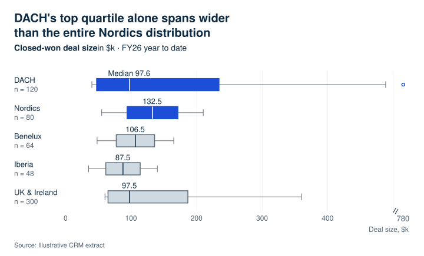

<details><summary>Spec: fixture <code>deal-size-by-region</code></summary>

```json
{
  "type": "box",
  "data": {
    "groups": [
      {
        "id": "dach",
        "label": "DACH",
        "observations": [
          40,
          40,
          40,
          40,
          40,
          40,
          40.1,
          40.1,
          40.1,
          40.2,
          40.3,
          40.4,
          40.5,
          40.6,
          40.7,
          40.9,
          41.1,
          41.3,
          41.6,
          41.9,
          42.2,
          42.5,
          42.9,
          43.3,
          43.8,
          44.3,
          44.8,
          45.4,
          46,
          46.7,
          47.4,
          48.1,
          48.9,
          49.8,
          50.7,
          51.7,
          52.7,
          53.8,
          55,
          56.2,
          57.5,
          58.8,
          60.2,
          61.7,
          63.3,
          64.9,
          66.6,
          68.3,
          70.2,
          72.1,
          74.1,
          76.2,
          78.4,
          80.6,
          83,
          85.4,
          87.9,
          90.6,
          93.3,
          96.1,
          99,
          102,
          105.1,
          108.3,
          111.6,
          115,
          118.5,
          122.1,
          125.8,
          129.7,
          133.6,
          137.7,
          141.9,
          146.2,
          150.6,
          155.2,
          159.8,
          164.6,
          169.5,
          174.6,
          179.8,
          185.1,
          190.5,
          196.1,
          201.8,
          207.6,
          213.6,
          219.8,
          226,
          232.4,
          239,
          245.7,
          252.6,
          259.6,
          266.7,
          274,
          281.5,
          289.1,
          296.9,
          304.9,
          313,
          321.2,
          329.7,
          338.3,
          347.1,
          356,
          365.1,
          374.4,
          383.9,
          393.5,
          403.3,
          413.3,
          423.5,
          433.9,
          444.4,
          455.2,
          466.1,
          477.2,
          488.5,
          780
        ]
      },
      {
        "id": "nordics",
        "label": "Nordics",
        "observations": [
          55,
          57,
          58.9,
          60.9,
          62.8,
          64.8,
          66.8,
          68.7,
          70.7,
          72.7,
          74.6,
          76.6,
          78.5,
          80.5,
          82.5,
          84.4,
          86.4,
          88.4,
          90.3,
          92.3,
          94.2,
          96.2,
          98.2,
          100.1,
          102.1,
          104.1,
          106,
          108,
          109.9,
          111.9,
          113.9,
          115.8,
          117.8,
          119.7,
          121.7,
          123.7,
          125.6,
          127.6,
          129.6,
          131.5,
          133.5,
          135.4,
          137.4,
          139.4,
          141.3,
          143.3,
          145.3,
          147.2,
          149.2,
          151.1,
          153.1,
          155.1,
          157,
          159,
          160.9,
          162.9,
          164.9,
          166.8,
          168.8,
          170.8,
          172.7,
          174.7,
          176.6,
          178.6,
          180.6,
          182.5,
          184.5,
          186.5,
          188.4,
          190.4,
          192.3,
          194.3,
          196.3,
          198.2,
          200.2,
          202.2,
          204.1,
          206.1,
          208,
          210
        ]
      },
      {
        "id": "benelux",
        "label": "Benelux",
        "observations": [
          48,
          49.9,
          51.7,
          53.6,
          55.4,
          57.3,
          59.1,
          61,
          62.9,
          64.7,
          66.6,
          68.4,
          70.3,
          72.1,
          74,
          75.9,
          77.7,
          79.6,
          81.4,
          83.3,
          85.1,
          87,
          88.9,
          90.7,
          92.6,
          94.4,
          96.3,
          98.1,
          100,
          101.9,
          103.7,
          105.6,
          107.4,
          109.3,
          111.1,
          113,
          114.9,
          116.7,
          118.6,
          120.4,
          122.3,
          124.1,
          126,
          127.9,
          129.7,
          131.6,
          133.4,
          135.3,
          137.1,
          139,
          140.9,
          142.7,
          144.6,
          146.4,
          148.3,
          150.1,
          152,
          153.9,
          155.7,
          157.6,
          159.4,
          161.3,
          163.1,
          165
        ]
      },
      {
        "id": "iberia",
        "label": "Iberia",
        "observations": [
          35,
          37.2,
          39.5,
          41.7,
          43.9,
          46.2,
          48.4,
          50.6,
          52.9,
          55.1,
          57.3,
          59.6,
          61.8,
          64,
          66.3,
          68.5,
          70.7,
          73,
          75.2,
          77.4,
          79.7,
          81.9,
          84.1,
          86.4,
          88.6,
          90.9,
          93.1,
          95.3,
          97.6,
          99.8,
          102,
          104.3,
          106.5,
          108.7,
          111,
          113.2,
          115.4,
          117.7,
          119.9,
          122.1,
          124.4,
          126.6,
          128.8,
          131.1,
          133.3,
          135.5,
          137.8,
          140
        ]
      },
      {
        "id": "uki",
        "label": "UK & Ireland",
        "observations": [
          60,
          60,
          60,
          60,
          60,
          60,
          60,
          60,
          60,
          60,
          60,
          60,
          60,
          60,
          60,
          60,
          60,
          60.1,
          60.1,
          60.1,
          60.1,
          60.1,
          60.1,
          60.1,
          60.2,
          60.2,
          60.2,
          60.2,
          60.2,
          60.3,
          60.3,
          60.3,
          60.4,
          60.4,
          60.4,
          60.5,
          60.5,
          60.6,
          60.6,
          60.7,
          60.7,
          60.8,
          60.8,
          60.9,
          61,
          61,
          61.1,
          61.2,
          61.2,
          61.3,
          61.4,
          61.5,
          61.6,
          61.7,
          61.8,
          61.9,
          62,
          62.1,
          62.2,
          62.3,
          62.4,
          62.5,
          62.7,
          62.8,
          62.9,
          63.1,
          63.2,
          63.4,
          63.5,
          63.7,
          63.8,
          64,
          64.2,
          64.4,
          64.5,
          64.7,
          64.9,
          65.1,
          65.3,
          65.5,
          65.7,
          66,
          66.2,
          66.4,
          66.7,
          66.9,
          67.1,
          67.4,
          67.6,
          67.9,
          68.2,
          68.5,
          68.7,
          69,
          69.3,
          69.6,
          69.9,
          70.2,
          70.6,
          70.9,
          71.2,
          71.6,
          71.9,
          72.3,
          72.6,
          73,
          73.4,
          73.7,
          74.1,
          74.5,
          74.9,
          75.3,
          75.8,
          76.2,
          76.6,
          77.1,
          77.5,
          78,
          78.4,
          78.9,
          79.4,
          79.9,
          80.4,
          80.9,
          81.4,
          81.9,
          82.5,
          83,
          83.5,
          84.1,
          84.7,
          85.2,
          85.8,
          86.4,
          87,
          87.6,
          88.2,
          88.9,
          89.5,
          90.1,
          90.8,
          91.5,
          92.1,
          92.8,
          93.5,
          94.2,
          94.9,
          95.7,
          96.4,
          97.1,
          97.9,
          98.6,
          99.4,
          100.2,
          101,
          101.8,
          102.6,
          103.4,
          104.3,
          105.1,
          106,
          106.8,
          107.7,
          108.6,
          109.5,
          110.4,
          111.3,
          112.3,
          113.2,
          114.2,
          115.1,
          116.1,
          117.1,
          118.1,
          119.1,
          120.1,
          121.2,
          122.2,
          123.3,
          124.4,
          125.5,
          126.5,
          127.7,
          128.8,
          129.9,
          131.1,
          132.2,
          133.4,
          134.6,
          135.8,
          137,
          138.2,
          139.4,
          140.7,
          141.9,
          143.2,
          144.5,
          145.8,
          147.1,
          148.4,
          149.8,
          151.1,
          152.5,
          153.9,
          155.3,
          156.7,
          158.1,
          159.5,
          161,
          162.5,
          163.9,
          165.4,
          166.9,
          168.5,
          170,
          171.5,
          173.1,
          174.7,
          176.3,
          177.9,
          179.5,
          181.1,
          182.8,
          184.5,
          186.1,
          187.8,
          189.5,
          191.3,
          193,
          194.8,
          196.5,
          198.3,
          200.1,
          202,
          203.8,
          205.7,
          207.5,
          209.4,
          211.3,
          213.2,
          215.1,
          217.1,
          219.1,
          221,
          223,
          225,
          227.1,
          229.1,
          231.2,
          233.3,
          235.4,
          237.5,
          239.6,
          241.7,
          243.9,
          246.1,
          248.3,
          250.5,
          252.7,
          255,
          257.3,
          259.5,
          261.8,
          264.2,
          266.5,
          268.9,
          271.2,
          273.6,
          276,
          278.5,
          280.9,
          283.4,
          285.8,
          288.3,
          290.9,
          293.4,
          296,
          298.5,
          301.1,
          303.7,
          306.4,
          309,
          311.7,
          314.4,
          317.1,
          319.8,
          322.5,
          325.3,
          328.1,
          330.9,
          333.7,
          336.6,
          339.4,
          342.3,
          345.2,
          348.1,
          351.1,
          354,
          357,
          360
        ]
      }
    ]
  },
  "options": {
    "showObservations": "small-n",
    "title": "DACH's top quartile alone spans wider than the entire Nordics distribution",
    "subtitle": { "measure": "Closed-won deal size", "period": "FY26 year to date" },
    "unit": "$k",
    "source": "Illustrative CRM extract",
    "valueAxis": { "show": true, "gridlines": true },
    "axisTitles": { "primary": "Deal size, $k" },
    "boxValues": "median",
    "highlight": ["dach", "nordics"]
  }
}
```

</details>

### pyramid

Mirrored bands on one scale. [Reference](reference/pyramid.md)

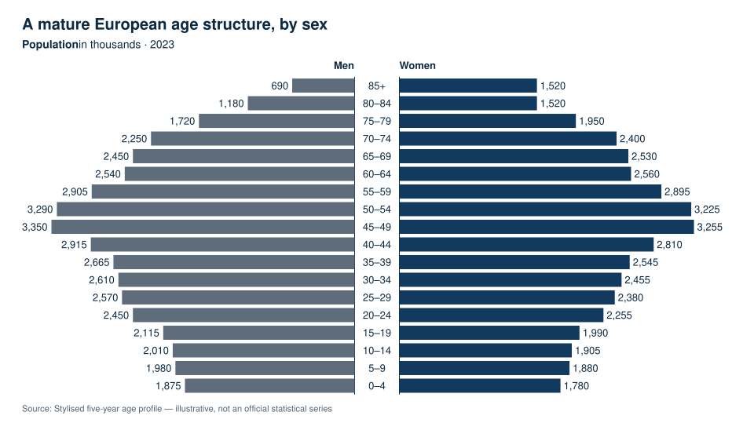

<details><summary>Spec: fixture <code>germany-age-structure</code></summary>

```json
{
  "type": "pyramid",
  "data": {
    "bands": [
      { "id": "a0", "from": 0, "to": 5, "label": "0–4" },
      { "id": "a5", "from": 5, "to": 10, "label": "5–9" },
      { "id": "a10", "from": 10, "to": 15, "label": "10–14" },
      { "id": "a15", "from": 15, "to": 20, "label": "15–19" },
      { "id": "a20", "from": 20, "to": 25, "label": "20–24" },
      { "id": "a25", "from": 25, "to": 30, "label": "25–29" },
      { "id": "a30", "from": 30, "to": 35, "label": "30–34" },
      { "id": "a35", "from": 35, "to": 40, "label": "35–39" },
      { "id": "a40", "from": 40, "to": 45, "label": "40–44" },
      { "id": "a45", "from": 45, "to": 50, "label": "45–49" },
      { "id": "a50", "from": 50, "to": 55, "label": "50–54" },
      { "id": "a55", "from": 55, "to": 60, "label": "55–59" },
      { "id": "a60", "from": 60, "to": 65, "label": "60–64" },
      { "id": "a65", "from": 65, "to": 70, "label": "65–69" },
      { "id": "a70", "from": 70, "to": 75, "label": "70–74" },
      { "id": "a75", "from": 75, "to": 80, "label": "75–79" },
      { "id": "a80", "from": 80, "to": 85, "label": "80–84" },
      { "id": "a85", "from": 85, "label": "85+" }
    ],
    "groups": [
      {
        "id": "m",
        "label": "Men",
        "values": [
          1875,
          1980,
          2010,
          2115,
          2450,
          2570,
          2610,
          2665,
          2915,
          3350,
          3290,
          2905,
          2540,
          2450,
          2250,
          1720,
          1180,
          690
        ]
      },
      {
        "id": "f",
        "label": "Women",
        "values": [
          1780,
          1880,
          1905,
          1990,
          2255,
          2380,
          2455,
          2545,
          2810,
          3255,
          3225,
          2895,
          2560,
          2530,
          2400,
          1950,
          1520,
          1520
        ]
      }
    ]
  },
  "options": {
    "size": { "width": 960, "height": 539 },
    "title": "A mature European age structure, by sex",
    "subtitle": { "measure": "Population", "period": "2023" },
    "unit": "thousands",
    "source": "Stylised five-year age profile — illustrative, not an official statistical series"
  }
}
```

</details>

## Surveys and maps

### choropleth

Region map coloured by value. [Reference](reference/choropleth.md)

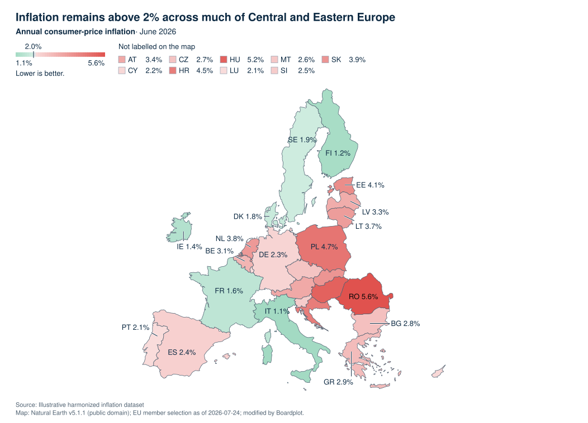

<details><summary>Spec: fixture <code>eu-inflation-values</code></summary>

```json
{
  "type": "choropleth",
  "data": {
    "pack": "eu27",
    "regions": [
      { "id": "AT", "value": 3.4 },
      { "id": "BE", "value": 3.1 },
      { "id": "BG", "value": 2.8 },
      { "id": "HR", "value": 4.5 },
      { "id": "CY", "value": 2.2 },
      { "id": "CZ", "value": 2.7 },
      { "id": "DK", "value": 1.8 },
      { "id": "EE", "value": 4.1 },
      { "id": "FI", "value": 1.2 },
      { "id": "FR", "value": 1.6 },
      { "id": "DE", "value": 2.3 },
      { "id": "GR", "value": 2.9 },
      { "id": "HU", "value": 5.2 },
      { "id": "IE", "value": 1.4 },
      { "id": "IT", "value": 1.1 },
      { "id": "LV", "value": 3.3 },
      { "id": "LT", "value": 3.7 },
      { "id": "LU", "value": 2.1 },
      { "id": "MT", "value": 2.6 },
      { "id": "NL", "value": 3.8 },
      { "id": "PL", "value": 4.7 },
      { "id": "PT", "value": 2.1 },
      { "id": "RO", "value": 5.6 },
      { "id": "SK", "value": 3.9 },
      { "id": "SI", "value": 2.5 },
      { "id": "ES", "value": 2.4 },
      { "id": "SE", "value": 1.9 }
    ]
  },
  "options": {
    "title": "Inflation remains above 2% across much of Central and Eastern Europe",
    "subtitle": { "measure": "Annual consumer-price inflation", "period": "June 2026" },
    "format": "1.1%",
    "scale": { "kind": "diverging", "midpoint": 2, "polarity": "lowerIsBetter" },
    "source": "Illustrative harmonized inflation dataset",
    "size": "a4",
    "regionValues": true
  }
}
```

</details>

### likert

Diverging bars for survey scales. [Reference](reference/likert.md)

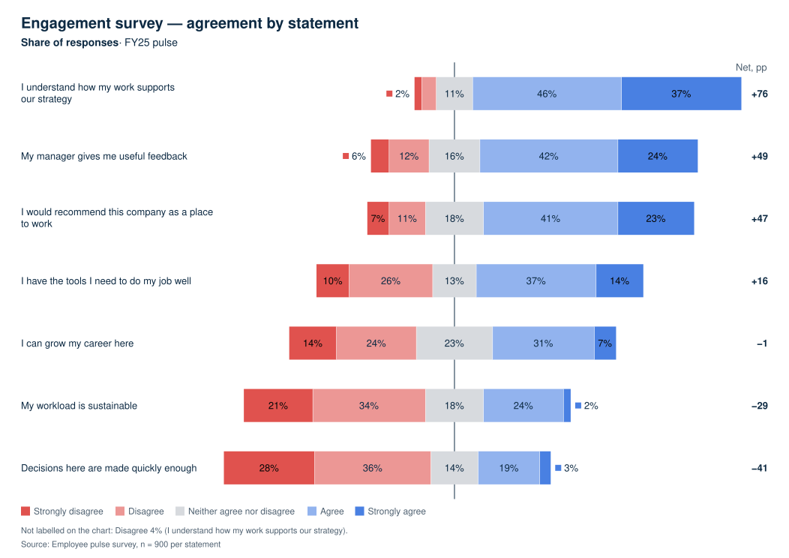

<details><summary>Spec: fixture <code>employee-engagement-5pt</code></summary>

```json
{
  "type": "likert",
  "data": {
    "scale": [
      { "id": "sd", "label": "Strongly disagree" },
      { "id": "d", "label": "Disagree" },
      { "id": "n", "label": "Neither agree nor disagree", "role": "neutral" },
      { "id": "a", "label": "Agree" },
      { "id": "sa", "label": "Strongly agree" }
    ],
    "items": [
      {
        "id": "purpose",
        "label": "I understand how my work supports our strategy",
        "values": [20, 40, 100, 410, 330]
      },
      {
        "id": "manager",
        "label": "My manager gives me useful feedback",
        "values": [50, 110, 140, 380, 220]
      },
      {
        "id": "tools",
        "label": "I have the tools I need to do my job well",
        "values": [90, 230, 120, 330, 130]
      },
      {
        "id": "workload",
        "label": "My workload is sustainable",
        "values": [190, 310, 160, 220, 20]
      },
      { "id": "growth", "label": "I can grow my career here", "values": [130, 220, 210, 280, 60] },
      {
        "id": "speed",
        "label": "Decisions here are made quickly enough",
        "values": [250, 320, 130, 170, 30]
      },
      {
        "id": "recommend",
        "label": "I would recommend this company as a place to work",
        "values": [60, 100, 160, 370, 210]
      }
    ]
  },
  "options": {
    "size": "a4",
    "values": "counts",
    "neutral": "split",
    "summary": "net",
    "sortBy": "net",
    "labelDensity": "full",
    "notes": { "show": ["note", "disclosure"] },
    "title": "Engagement survey — agreement by statement",
    "subtitle": {
      "measure": "Share of responses",
      "period": "FY25 pulse",
      "scenarios": ["Neutral split across the centre line"]
    },
    "legend": "bottom",
    "source": "Employee pulse survey, n = 900 per statement",
    "requiredNotes": { "neutral": false, "base": false }
  }
}
```

</details>

### tilemap

Equal-size region tiles. [Reference](reference/tilemap.md)

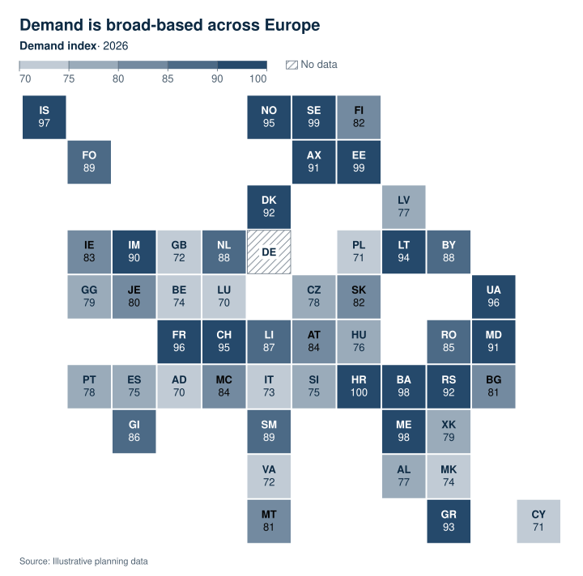

<details><summary>Spec: fixture <code>europe-tile-grid</code></summary>

```json
{
  "type": "tilemap",
  "data": {
    "pack": "europe",
    "regions": [
      { "id": "AD", "value": 70 },
      { "id": "AL", "value": 77 },
      { "id": "AT", "value": 84 },
      { "id": "AX", "value": 91 },
      { "id": "BA", "value": 98 },
      { "id": "BE", "value": 74 },
      { "id": "BG", "value": 81 },
      { "id": "BY", "value": 88 },
      { "id": "CH", "value": 95 },
      { "id": "CY", "value": 71 },
      { "id": "CZ", "value": 78 },
      { "id": "DE", "value": null },
      { "id": "DK", "value": 92 },
      { "id": "EE", "value": 99 },
      { "id": "ES", "value": 75 },
      { "id": "FI", "value": 82 },
      { "id": "FO", "value": 89 },
      { "id": "FR", "value": 96 },
      { "id": "GB", "value": 72 },
      { "id": "GG", "value": 79 },
      { "id": "GI", "value": 86 },
      { "id": "GR", "value": 93 },
      { "id": "HR", "value": 100 },
      { "id": "HU", "value": 76 },
      { "id": "IE", "value": 83 },
      { "id": "IM", "value": 90 },
      { "id": "IS", "value": 97 },
      { "id": "IT", "value": 73 },
      { "id": "JE", "value": 80 },
      { "id": "LI", "value": 87 },
      { "id": "LT", "value": 94 },
      { "id": "LU", "value": 70 },
      { "id": "LV", "value": 77 },
      { "id": "MC", "value": 84 },
      { "id": "MD", "value": 91 },
      { "id": "ME", "value": 98 },
      { "id": "MK", "value": 74 },
      { "id": "MT", "value": 81 },
      { "id": "NL", "value": 88 },
      { "id": "NO", "value": 95 },
      { "id": "PL", "value": 71 },
      { "id": "PT", "value": 78 },
      { "id": "RO", "value": 85 },
      { "id": "RS", "value": 92 },
      { "id": "SE", "value": 99 },
      { "id": "SI", "value": 75 },
      { "id": "SK", "value": 82 },
      { "id": "SM", "value": 89 },
      { "id": "UA", "value": 96 },
      { "id": "VA", "value": 72 },
      { "id": "XK", "value": 79 }
    ]
  },
  "options": {
    "title": "Demand is broad-based across Europe",
    "subtitle": { "measure": "Demand index", "period": "2026" },
    "source": "Illustrative planning data",
    "format": "100",
    "classes": 5,
    "scale": { "kind": "sequential" }
  }
}
```

</details>
